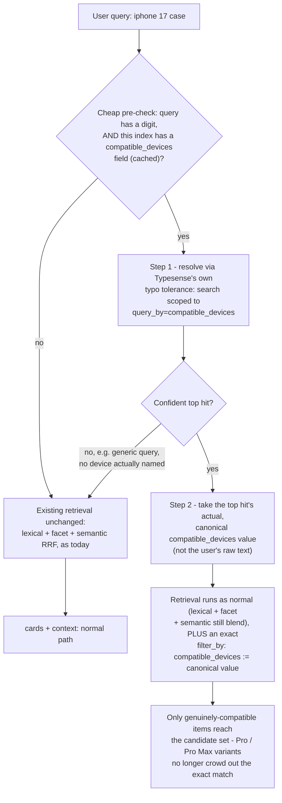

# Exact Device-Variant Matching for Accessories ("iPhone 17" vs "iPhone 17 Pro Max")

> **Status: Implemented.** Live as `resolve_field_value_filter` in
> `backend/src/isp/services/infra/chat/query_filters.py`, called from
> `chat/service.py` (single-search + superlative paths) and per-plan from
> `chat/multi_intent.py`. This document captures the original design as
> discussed and agreed, following the same "verify before implementing"
> pattern used elsewhere in this project — see the renamed-function note in
> §2 for what changed on the way to landing.

## Problem

Chat retrieval currently distinguishes device variants only through fuzzy
lexical text matching. "iPhone 17", "iPhone 17 Pro", and "iPhone 17 Pro Max"
all share the token "17", so a query naming one specific variant can't be
reliably separated from its siblings at the retrieval layer.

Traced live from a real conversation: for `"iphone 17 case"`, retrieval's
RRF-merged top-5 only included 2 of the 3 real ZAGG Rainier variants (Pro and
Pro Max) — the plain "iPhone 17" one didn't make the cutoff, crowded out by
the many other Rainier variants across other phone brands also lexically
matching "17"-adjacent tokens. The LLM went on to describe the plain "iPhone
17" Rainier case anyway, in text — a real product, just not one it had
actually been given in that turn's context, so the mention wasn't grounded in
what it was shown even though the product itself turned out to exist.

## Why not fix this at the generation layer

The disambiguating fact was already present, explicitly, in whatever context
*was* retrieved — each item's `compatible_devices` value is precise and
unambiguous per product. The failure wasn't missing information; it was
retrieval not surfacing the right candidate set in the first place, and the
model not staying strictly within what it was given. Prompt wording can't fix
a candidate that was never in the context — the same lesson already
established for the superlative-price feature: fix the layer that actually
owns the answer, not the layer that has to describe whatever it's handed.

## Confirmed schema reality (checked live, not assumed)

```
Phones:         compatible_devices — NO   (a phone isn't "compatible with" anything, it IS the device)
Accessories:    compatible_devices — YES
Smartwatches:   compatible_devices — NO
Tablets:        compatible_devices — NO
```

Only accessories genuinely need a compatibility field at all. This must be a
conditional, schema-checked path — not something that runs universally, the
same principle already applied to the price/budget-mention fix earlier.

## Flow



The key design choice, different from the superlative-price feature: this is
a **narrowing filter**, not a full ranking override. "Which case is best for
my iPhone 17" is still a genuine relevance question once scoped to the right
device — unlike a superlative query, there's no single objectively-correct
order here, so lexical/facet/semantic blending still runs, just now correctly
scoped to the exact variant instead of blending across near-duplicate names.

## Implementation

### 1. Cheap pre-check

Reuse `_HAS_NUMBER_RE` (already built for vague-preference detection) as a
free gate — most queries either have no digit at all ("what colors do you
have") or hit an index without the field, so this keeps the added cost near
zero for the common case:

```python
async def _should_resolve_device(query: str, index_id: str, cached_map: dict) -> bool:
    if not _HAS_NUMBER_RE.search(query):
        return False
    field = await _resolve_concept_field(index_id, "device_compatibility", cached_map)
    return field is not None
```

### 2. Two-step resolution

> **2026-09 — renamed to `resolve_field_value_filter` (public, no leading
> underscore) and moved to `chat/query_filters.py`.** Nothing about the
> implementation is device-specific (the model-number narrowing near the end
> is the one device-flavored refinement, and it's a no-op for non-numeric
> queries) — it's parameterized by `field_name` and was already reused as-is
> for shared-span validation (`resolve_span_for_index`, in
> `chat/concept_resolution.py`). It now has a second, unrelated caller:
> `customer_eligibility` resolution (`superlativePriceDesign.md` §7) needed
> the identical two-step "typo-tolerant resolve against real values, then
> filter to the top hit's actual value" pattern, just against
> `customer_group` instead of `compatible_devices` — reused rather than
> duplicated. One difference in that caller: it passes the isolated matched
> word, not the full query — see §7 for why a `customer_group` value (one
> common word) needs that where a device name (a long, distinctive phrase)
> doesn't. A third caller was added later still: `chat/multi_intent.py`
> resolves it per-segment (not just once for the whole message) so a
> multi-item message can narrow each item to its own device.

```python
async def resolve_field_value_filter(
    query: str, index_id: str, field_name: str,
) -> str | None:
    """
    Step 1: let Typesense's own typo tolerance resolve messy input against
    the real values field_name actually holds on this index. Step 2: use the
    top hit's actual value (not the user's raw text) to build a precise
    filter. Returns None (no filter, fall through to normal retrieval) when
    there's no confident match — e.g. a generic query that doesn't name a
    value this field has.
    """
    col    = ts.collection_name(index_id)
    client = ts.get_client()
    resp = await asyncio.to_thread(
        lambda: client.multi_search.perform({"searches": [{
            "collection": col, "q": query, "query_by": field_name,
            "per_page": "1", "exclude_fields": "vec",
        }]}, {})
    )
    hits = resp.get("results", [{}])[0].get("hits", [])
    if not hits:
        return None
    resolved = hits[0]["document"].get(field_name)
    values = resolved if isinstance(resolved, list) else [resolved]
    values = [v for v in values if v]
    if not values:
        return None
    quoted = ",".join(f"`{v}`" for v in values)
    return f"{field_name}:=[{quoted}]"
```

### 3. Field resolution + caching — reuse, don't rebuild

Identical shape to `_resolve_superlative_field` / `superlative_field_map`
already built for the price feature: concept → candidate field names →
schema-checked → write-through cached per index. Extends the same cache with
a new concept key rather than a parallel mechanism:

```python
_CONCEPT_FIELD_CANDIDATES["device_compatibility"] = [
    "compatible_devices", "compatible_with", "device_compatibility",
]
```

Resulting cache entry, e.g. on Accessories:
`{"price": "price", "device_compatibility": "compatible_devices"}`.

**One honest naming note**: the column is currently called
`superlative_field_map`, which becomes a slight misnomer once it also holds a
non-superlative concept. Acceptable as an internal implementation detail for
now — worth a rename (e.g. `resolved_field_map`) if this reuse pattern grows
to a third concept type.

### 4. Retrieval integration

When resolution succeeds, add the resolved `filter_by` to the existing RRF
search passes (`_build_search_params`, now in `chat/retrieval.py` after the
module split) alongside whatever price filter is already present — unlike
the superlative path, `_rrf_merge` still runs; this only narrows the
candidate set, it doesn't override ranking.

**Known gap, found later (2026-09), not yet fixed:** this narrowing filter
is applied unconditionally whenever a device is named — including for a
device-*universal* category (headphones, speakers, chargers) that doesn't
list any specific phone in `compatible_devices` at all. A query like
"wireless earbuds for iPhone 18 Pro" gets the same hard
`compatible_devices:=[...]` filter a case query gets, which excludes every
real earbud product and silently returns cases instead — non-empty, so the
existing empty-result fallback elsewhere in the codebase doesn't catch it.
Confirmed live that dropping the hard filter and relying on
`compatible_devices`'s existing 10x query_by weight for *ranking* instead
of filtering fixes this without regressing the original crowding case this
doc was written for (`"iphone 17 case"` still puts the plain "iPhone 17"
variant first through weighting alone) — but doing that for the
superlative-sort path specifically loses the narrowing with no ranking
mechanism to fall back on, since a pure `sort_by` doesn't blend relevance.
Attempted and reverted in the same session it was found (needs its own
follow-up, not a same-session turnaround) — see
`docs/multiIntentConjunctionSearchDesign.md`'s "known gaps" for the sibling
issue this shares a root cause with (multi_intent's per-plan resolution
already gates this correctly via `_is_device_fit_category`; this
whole-message path never got the equivalent gate).

### 5. Verification

- `"iphone 17 case"` → confirm the plain "Apple iPhone 17" Rainier case is now
  reliably included, no longer crowded out by Pro/Pro Max variants.
- `"ihpone17 promax case"` (typo, no space) → confirm it still resolves to
  `"Apple iPhone 17 Pro Max"` via Typesense's native tolerance in step 1.
- `"phone case"` (no device named) → confirm no filter applied, normal
  retrieval unchanged, no false-positive narrowing.
- On Phones / Smartwatches / Tablets (no `compatible_devices` field) →
  confirm the pre-check and cached negative result skip this path entirely,
  no wasted Typesense calls.
- Regression: existing Accessories chat behavior for queries that already
  worked correctly (e.g. queries with no digit, or generic browsing) stays
  unchanged.

## Decisions summary

- **Two-step resolution, not one exact-match check** — delegates typo/spacing
  tolerance to Typesense's own already-proven matching (step 1) instead of
  writing new fuzzy-matching code, then filters precisely on the confirmed
  canonical value (step 2), rather than fuzzy-matching at filter time.
- **Narrowing filter, not a ranking override** — unlike the superlative-price
  feature, there's no single objectively correct order for "best case for my
  iPhone 17," so RRF blending still runs; this only scopes the candidate set
  to the right device first.
- **Schema-checked and cached, not universal** — confirmed live that only
  Accessories has this field; reuses the exact same concept-resolution and
  caching mechanism already built and proven for superlative price queries,
  rather than a parallel implementation.
- **Confidence-gated fallback, not a forced guess** — a query that doesn't
  confidently resolve to a real device value falls through to normal
  retrieval unchanged, the same principle already used for unmapped
  superlatives and no-field indexes.

## Appendix: source-data audit (`device_compatibility_accessories.js`)

Everything above assumes `compatible_devices` values are trustworthy. They
aren't automatically — the extension that produces them
(`device_compatibility_accessories.js`) parses a `"for X"` phrase out of
each product's display name, and a phrase can *look* like a device list
without being one.

**Found live, via chat, one at a time (the slow way):**
`"GoTo® Device Cleaning Kit for AirPods, smartphones, and other mobile
devices"` — a universal catch-all phrase, not a real device list — got
parsed into `["AirPods", "AirPods smartphones", "AirPods other mobile
devices"]`. The extension's shared-prefix propagation (for legitimate
multi-device titles like `"for iPhone 16 Plus/15 Plus"`) doesn't
distinguish a real model list from a marketing phrase, so it prepended
`"AirPods"` onto every comma-separated fragment, generic nouns included.

**Found by auditing every accessory title in the catalog against the
extraction function directly, in one pass, instead of waiting for each
phrasing to surface through a live query:**
```
"UAG Metropolis Wallet with Stand for UNIVERSAL"        -> ["UNIVERSAL"]
"PureGear Metal Ring Sticker 2-Pack for Universal"      -> ["Universal"]
"PureGear Magnetic Grip Kickstand for Universal"        -> ["Universal"]
"CaseMate Cleaning Kit for Universal"                   -> ["Universal"]
"PopSockets PopWallet+ for Magnetic"                    -> ["Magnetic"]
"PopSockets PopGrip for Magnetic"                       -> ["Magnetic"]
"PopSockets LowPro Grip for Magnetic"                   -> ["Magnetic"]
"PopSockets Kick-out Grip for Magnetic"                 -> ["Magnetic"]
```
Same bug class — `"Universal"` is the same catch-all pattern under a
different word; `"Magnetic"` is a product-*variant* descriptor (the
magnetic-attach version of a grip/wallet), not a device reference at all.
All 8 now correctly resolve to `device_universal: true` after extending
`_GENERIC_DEVICE_RE` in the extension.

**Fixed by auditing, not exhaustively — worth re-running.** The audit
script (fetch every accessory document, re-run `transform()` against each
`display`, flag any `compatible_devices` entry that doesn't start with a
recognized device-family prefix) is a cheap, one-time pass — cheaper than
finding the next instance through a customer's chat message. It's not run
automatically anywhere yet; re-run it by hand after any catalog change that
adds new brands or new generic phrasing conventions, or wire it into the
extension's own test/validation step if one gets built.

**Left alone, not a bug**: `"PureGear Universal Swivel Case for
9-11-inch Tablets"` — a genuine (if generic) size-based compatibility
statement, not a catch-all phrase. Different in kind from `"Universal"`/
`"Magnetic"`: it actually constrains which devices fit, just not to one
named model.
