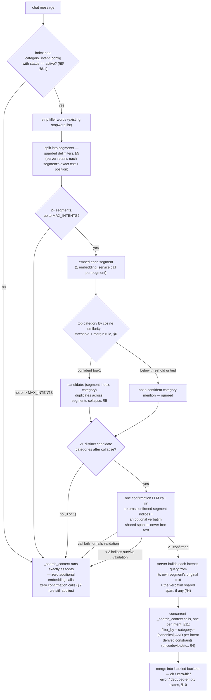
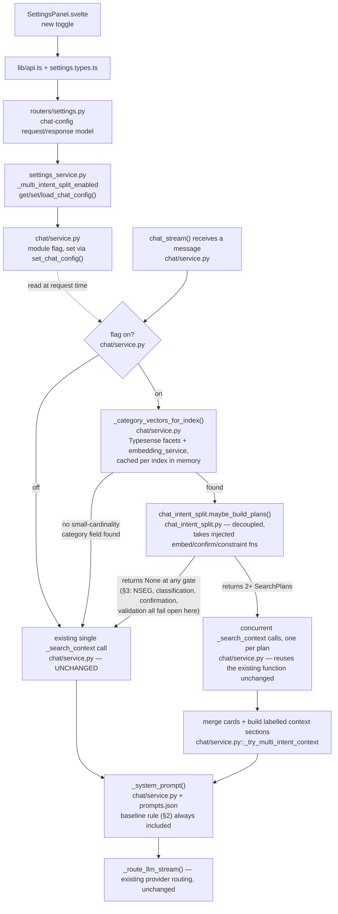

# Multi-Intent Conjunction Chat Retrieval — Design

Status: **V1 implemented** (§15.1 — behind the `multi_intent_split` Settings
toggle). §15.2's persisted per-index config layer remains proposed, not
implemented.

## 1. Objective

Chat-only. A customer can name more than one thing in one message:

> "can you show me iphone 17 screen protector and cases and compatible headphones"

Live-reproduced bug: chat replies "We don't have anything matching that right
now for iPhone 17 screen protectors and cases" — false; the catalog has
plenty of both. Traced to `chat/service.py::_search_context`: it runs **one**
blended query and `_rrf_merge` keeps only the **top 5** merged hits.
Whichever category dominates that single blended ranking (here, headphones)
consumes the entire 5-slot budget; the other categories get zero context
handed to the LLM, which then reports them as unavailable — not a
hallucination, a starvation-of-context bug.

**Not for the search-results page.** That page already has an exact,
zero-risk tool for the same need — the category facet checkboxes. Chat has
no such fallback; text is the only interface, and it already pays LLM
latency per turn.

## 2. Baseline safety rule — applies to every path, not just the fix

Detection can miss, the configured-field gate (§3) can fail, `MAX_INTENTS`
can be exceeded, the confirmation call can fail or get validated away (§7).
Every one of those returns to the existing single `_search_context` call —
the exact retrieval path that produced the original bug.

So this is a system-prompt rule, stated once, applied unconditionally:

> Retrieved context is a sample of matching results, not an exhaustive
> inventory check. If something the customer asked for doesn't appear in
> what was retrieved, say you couldn't find a matching item — never state or
> imply the catalog doesn't carry it.

This also fixes today's plain single-intent path, at zero cost, independent
of whether any of the rest of this document ships.

## 3. Pipeline



## 4. Per-intent query text and constraint composition

**The model never writes query text.** The confirmation call (§7) returns
only segment indices and, optionally, one verbatim shared span — the
**server** builds every final query from the original message:

```
intent.query = (shared_span + " " + segment_text[i]).strip()   # or suffixed, per position — see §7
```

Because each segment's own text is exactly what §5's deterministic split
produced (never rewritten), a local modifier (`"red"`, `"under $20"`,
`"noise-canceling"`) can never end up in the wrong bucket, be dropped, or be
invented — it simply never leaves the segment it was already in. Only a
verbatim, position-validated shared span (§7) can apply to more than one
intent, and it applies identically to all of them, never selectively — so a
swap like attaching `"$100"` to the cases bucket and `"$20"` to headphones
is structurally impossible, not just checked-for.

**Text alone is not enforcement.** Each intent's server-built text is run
through the **existing** price-extraction utilities already in
`chat/service.py` (`_extract_price_filter` / `_price_filter_for_smart`) —
once per intent instead of once per whole message — and the result is
combined with the category clause by `AND`:

```
filter_by = "(category:=[cases-&-covers]) && (price:<=20)"
```

No change to those extraction algorithms themselves — only the invocation
pattern changes, from once per message to once per intent.

**Device resolution is a deliberate exception, not per-intent.** Unlike
price, device resolution is not re-run once per intent's own text. As
shipped, it resolves once against the *whole* message (as it already did
pre-split), and only retries per-segment if that whole-message resolution
came back empty — Typesense's own token-dropping is positional, and a real
device name can fail to resolve mid-sentence in a long multi-category
message even though the same text resolves cleanly alone. The **same**
resolved filter is then applied to every confirmed intent, with a per-plan
runtime fallback: if AND-ing it in zeroes out a bucket's hits (e.g.
headphones are commonly sold as a universal accessory, untagged to any
device, unlike device-specific cases or screen protectors), that bucket's
search is retried without it rather than reporting a false
"we don't carry this." A message naming two different devices for two
different categories in one turn is not handled distinctly by this
exception — both buckets get whichever device resolved from the whole
message.

**Known open gap — `strip_phrases` matching, not addressed by this
document's fixes.** §6's classification step strips a resolved device
phrase out of a segment's text before embedding it (a device name
measurably dilutes the embedding away from the category concept — see
`_strip_phrases` in `chat_intent_split.py`). It does an exact,
case-insensitive substring match against the *resolved* device value
(e.g. `"Apple iPhone 17"`, Typesense's canonical form, brand prefix
included) — not against whatever the customer actually typed (e.g.
`"iphone 17"`, no brand). When those two forms don't match verbatim,
nothing gets stripped, the segment keeps the diluting device tokens, and
it can silently fail to classify at all — observed live on exactly this
shape of message. This is a real, separate gap from everything else in
this section; it isn't fixed by the `shared_span` tiering in §7, and isn't
designed here.

## 5. Splitting rules

- **Delimiters**: `" and "`, `" & "`, and `,`. Not `"or"` (falls through to
  the fallback). Not an unspaced `&` (appears inside facet values and brand
  strings).
- **Protected patterns** — do not split at a delimiter when:
  - both immediately adjacent tokens are numeric/currency-like (`"$20 and
    $50"`, `"between $20 and $50"`);
  - a comma sits between two digit groups of the same number (`"1,000"`).
- **MAX_INTENTS = 4.** More segments than that → skip classification, go to
  the fallback.
- **Duplicate categories collapse.** Two segments classifying to the same
  canonical category are one candidate bucket; §7 still receives them as
  separate segment indices, but the "2+ distinct categories" gate counts
  post-collapse. If both survive confirmation, the server concatenates
  both segments' text as that bucket's final query (still no free-text
  rewriting involved).

## 6. Category classification

- Category values are embedded per §8's lifecycle — never on the request
  path.
- **Top-1 with a margin, not top-k.** A segment's classification is its
  single highest-scoring category, only if that score clears the
  similarity threshold *and* beats the second-best candidate by a minimum
  margin (both stored per §8). A near-tie is **not classified** — a wrong
  category assignment is more dangerous than a missed one, because unlike
  a false-positive category (caught by §7), a wrong one looks equally
  confident and isn't caught downstream.
- **Cost, precisely**: 1 embedding API call per segment, incurred only once
  §5's split already produced 2+ segments past §3's gate 0. On an ordinary
  single-intent message, or an index with no configured field, this is
  zero additional embedding calls and zero confirmation calls — not zero
  embedding calls outright: `_search_context`'s own existing
  retrieval-embedding call and the final answer-generation LLM call happen
  on every message regardless, fallback included, exactly as today.
- **Threshold favors recall, not precision.** A false positive is caught by
  the confirmation call at the cost of one extra LLM call. A false
  negative gets no safety net — it silently reproduces the original bug.
  Pick the threshold and margin empirically, in shadow mode (§13), against
  a labeled query set — biased toward over-suggesting candidates.
- **V1's empirically-tuned default is 0.55, not the originally-guessed
  0.62.** Against the deployment's actual embed model, 0.62 silently
  dropped genuine matches — e.g. "screen protector" vs. the category
  "screen-protectors" scores 0.56 cosine, below that floor. §8's `values`
  config still lets an operator retune per index; V1 (§15.1, no persisted
  config yet) hardcodes 0.55/0.05 as the module default.

## 7. Confirmation call

> **2026-09 — currently bypassed in the live wiring.** `chat/service.py`
> calls `maybe_build_plans` with `confirm=None`; when `confirm` is `None`,
> every candidate §6 found is auto-confirmed and `shared_span` is always
> `None` — this whole section's LLM call, and the two-tier validation below,
> never execute. The reasoning: `classify_segments`' own confidence+margin
> gate is trusted directly as "confirmed" without a second LLM opinion, and
> device-per-category scoping (this section's `shared_span` use case) is
> now resolved deterministically per plan instead — see
> `multi_intent.py::_is_device_fit_category` and the "Known gaps" section
> below for what that mechanism doesn't cover yet. The design below is kept
> as the documented fallback shape (`confirm` still accepts a real callable
> and everything in this section still applies if one is passed) rather
> than deleted, since nothing about it was wrong — it was superseded, not
> broken.

Fires only when §5/§6 already found 2+ distinct candidate categories.

**Structured output** — indices and a span, never composed text:

```json
{
  "confirmed_segments": [0, 2, 3],
  "shared_span": "iphone 17"
}
```

- `confirmed_segments`: a subset of the candidate segment indices §6
  proposed (0-based, matching split order). The model may return fewer
  than were proposed — dropping a false positive while confirming the
  rest — but can never introduce an index that wasn't a candidate.
- `shared_span`: optional. If present, it names a piece of the *original*
  message that applies to every confirmed intent — typically a device
  mention. It may sit outside every segment ("**iphone 17** case and
  headphones", named once up front) or be part of one segment's own text
  ("iphone 17 case and headphones" split into segments `["iphone 17
  case", "headphones"]`, where segment 0 already contains it) — either
  shape is valid; §9 covers not double-attaching it to a segment that
  already has it.

**Server-side validation — two tiers, not one blanket discard.** An earlier
version of this section failed the whole response on any validation miss,
`shared_span` included — the worked failure in §12 (Control G) shows why
that's wrong: a bad `shared_span` guess said nothing about whether
`confirmed_segments` was trustworthy, and discarding both regularly threw
away two perfectly good buckets over one bad field.

**Tier 1 — structural, invalidates the whole response, fails open to §2's
fallback:**

- every index in `confirmed_segments` was a proposed candidate;
- indices are unique;
- `len(confirmed_segments) < 2` after validation.

**Tier 2 — `shared_span`-specific. A failure here degrades `shared_span` to
`null` and keeps `confirmed_segments` as-is; it never discards them:**

- it's an exact, case-insensitive, verbatim substring of the original
  message;
- it's not purely numeric (a shared span is only ever legitimate as
  identity/context — a device or brand named once — never a quantity or
  price a model could use to move one segment's number onto another);
- it's not identical to one whole confirmed segment's own text (a "shared"
  span that's actually one segment's entire content, echoed back verbatim,
  signals there was no genuine cross-segment modifier at all);
- **it resolves against this index's device-compatibility vocabulary.**
  Checked via a fifth injected function alongside `embed`/`confirm`/
  `constraint_extractor`: `resolve_span: Callable[[str], Awaitable[bool]]`.
  The caller (`chat/service.py`) implements it as a thin wrapper over
  machinery that already exists and already runs once per request for the
  primary device filter — `_resolve_concept_field(index_id,
  "device_compatibility", ...)` finds the field (whatever it's actually
  named on this catalog, via `_match_field`'s exact-then-substring
  candidate matching — the same mechanism already used for `price`/
  `popularity`/`recency`/`size`/`rating`), then `_resolve_field_value_filter`
  (renamed from `_resolve_device_filter` in 2026-09 — see
  `superlativePriceDesign.md` §7, it's no longer device-only) checks whether
  the span resolves against it, both backed by Typesense's
  own typo tolerance, not new hand-written matching. **No new preprocessor
  extension, no new persisted config, no per-index human-review step** —
  this reuses exactly the field-resolution path and write-through cache
  (`indexes.superlative_field_map`) that device-filter resolution already
  has.
  - **Index-level gate, not a per-call fallback**: if `_resolve_concept_field`
    finds no device-compatibility field on this index at all,
    `shared_span` is *always* treated as absent, unconditionally — every
    call on that index, not a per-response judgment call. There is no
    vocabulary to validate an arbitrary claim against on an index with no
    such field (phones, smartwatches, tablets, plans, plants today — see
    [[deviceCompatibilityMatchingDesign.md]]'s field-applicability table).
    A future index-type that genuinely needs a different kind of shared
    context is a new, specific case to design when it's real, not
    something to pre-build speculatively here.

**The server assigns final bucket order and builds final query text** —
confirmed intents are ordered by their segment's position in the original
message; each intent's query is that segment's own original text, with the
verbatim `shared_span` prepended (if it occurred before the first confirmed
segment) or appended (if after the last) — **except for whichever confirmed
segment the span was itself drawn from** (its own text already contains it
verbatim, so it's left untouched rather than duplicated onto itself). Every
*other* confirmed segment gets it attached identically. The model supplies
no other text.

**Any call failure or Tier 1 validation failure** — timeout, malformed
JSON, schema violation, provider error/outage, or a `confirmed_segments`
that fails Tier 1 — resolves to "not confirmed," never a blocked or failed
chat response. A Tier 2 (`shared_span`-only) failure is not a call failure
— it resolves to a confirmed result with `shared_span: null`.

**Model**: the index's already-configured chat model/provider by default;
an optional `confirmation_model` override may be set per index (§8) for an
operator who wants a smaller/cheaper model for this narrower task.

## 8. Configuration lifecycle

- **Target field, gated explicitly and early (§3, gate 0)**: one setting
  per index names which facet field this feature classifies against, and
  whether it is live. Gate 0 checks `status == "active"` specifically —
  a `proposed` (§8.1) or absent config does not run, checked before any
  filler-stripping or splitting work, not an emergent property of later
  gates.
- **Storage**: one JSONB column on the `indexes` row,
  `category_intent_config`, default `{}`:
  ```json
  {
    "status": "active",
    "field": "category",
    "confirmation_model": null,
    "similarity_threshold": 0.55,
    "similarity_margin": 0.05,
    "values": {
      "cases-&-covers": {"phrase": "cases, covers, housing, sleeves", "label": "Cases & Covers"}
    }
  }
  ```
  `similarity_threshold`/`similarity_margin` are scoped per index (not
  global, not implicitly tied to a model version) because a value tuned
  for one embedding model does not transfer safely to another. Changing an
  index's `embed_model` invalidates its tuning as well as its vectors —
  both must be re-validated in shadow mode before re-enabling.
  Write-time validation checks each key under `values` is a currently-live
  value of the named field's facet.
- **One vector lifecycle, precompute-only, no lazy path**: category
  vectors are computed (a) on full rebuild, (b) whenever
  `category_intent_config` is edited, and (c) via an explicit manual
  refresh trigger (mirroring the reverted resolution engine's
  `refresh-vocab` pattern) — and preloaded into the in-memory cache for
  every index with a config row at process start, `proposed` included
  (§8.1) — so activation never has a cold start. There is no
  cache-miss/lazy-compute path. A category value added to the catalog
  without triggering one of (a)/(b)/(c) simply has no vector and cannot be
  classified into until the next trigger — a graceful, non-fatal gap, not
  an error. Because the set is small (a handful of values per index),
  recomputing the whole set on any trigger is cheap; there is no partial
  invalidation to get wrong.
- **Defaults are generated, not persisted per value.** A category value
  with no entry under `values` gets `phrase = label =
  value.replace('-', ' ').replace('&', 'and')` computed at the same
  precompute points above — so a brand-new category gets a (imperfect but
  working) vector on the next trigger without requiring a config write
  first.

### 8.1 Auto-discovery at index time — proposed, never auto-active

Scalability across every index, without hand-authoring config per index,
without auto-activating onto live chat traffic unreviewed:

- **Reuse, don't rebuild, discovery.** `affinity_service.discover_and_save`
  already scans every index's facets at rebuild time. Extend it: any
  facet field it finds with a small, stable value count (the same
  bounded-vocabulary property — e.g. ≤20 distinct values — that makes this
  whole feature safe in the first place, per the device-vocabulary
  contrast in earlier drafts) is a candidate.
- **Persisted, not ephemeral.** For each such candidate field, the same
  `discover_and_save` run **writes a `category_intent_config` row to the
  `indexes` table** with `status: "proposed"`, the candidate `field`,
  generated `values` phrases/labels (§8's default rule — free, no LLM
  call), and no `similarity_threshold`/`similarity_margin` set yet (left
  null; §6's thresholds require empirical tuning, not a guessed default).
  Vectors are computed for it immediately (§8), so it's ready the instant
  it's activated — no cold start.
- **Never overwrites an active config.** If an index already has
  `status: "active"` (an operator's prior confirmation, possibly with
  hand-edited phrases), rediscovery leaves it untouched — it only
  writes/refreshes `proposed` rows for fields with no existing entry.
  An operator's customization is never silently reverted by a rebuild.
- **Activation is one explicit step, always.** A `proposed` row never
  makes gate 0 pass on its own — an operator flips `status` to `"active"`
  (and, at that point, sets or accepts default `similarity_threshold`/
  `similarity_margin`) via the config endpoint (§15). This is deliberate,
  not a missing convenience: a low-cardinality field isn't always a
  shopping-category concept — `color`, `price_tier`, `availability` are
  small closed vocabularies too, and none of them are what a chat message
  should be split on. Auto-discovering the candidate is safe (inert until
  used); auto-activating it onto live answers without a human ever
  looking at it is the same class of mistake as the reverted
  device-vocabulary auto-inference — it fails silently and confidently,
  not obviously.

## 9. Search plan — the plan/execution boundary

Before any `_search_context` call runs, the server materializes one
**search plan** per confirmed intent — the explicit, inspectable contract
between "decide what to search" (§§3–8) and "execute the search" (§§10–11).
Nothing upstream of this list is a search yet; nothing downstream of it
re-derives intent from the original message again.

```json
{
  "plans": [
    {
      "category": "screen-protectors",
      "label": "Screen Protectors",
      "query": "iphone 17 screen protector",
      "filter_by": "category:=[screen-protectors]",
      "top_n": 2
    },
    {
      "category": "cases-&-covers",
      "label": "Cases & Covers",
      "query": "iphone 17 cases",
      "filter_by": "category:=[cases-&-covers]",
      "top_n": 2
    },
    {
      "category": "headphones",
      "label": "Headphones",
      "query": "iphone 17 compatible headphones",
      "filter_by": "category:=[headphones]",
      "top_n": 1
    }
  ]
}
```

- `category`/`label` from §8's config; `query` is the server-built text from
  §7 (never model-authored); `filter_by` is §4's composed clause (category
  AND any derived price/device constraint); `top_n` is §11's allocation.
- This list is exactly what shadow mode (§13) logs and evaluates — "what
  would this message have searched for" is answerable by inspecting the
  plan list alone, without running the searches or involving the LLM
  again.
- On the fallback path (§2's rule always applies regardless), no plan list
  is built at all — there is nothing to log beyond "fell back," which is
  itself one of the detector metrics §13 tracks.

## 10. Response construction

One `_search_context` call per confirmed intent (§11 for concurrency),
using the server-built query and composed `filter_by` (§4).

**Dedup**: if the same product id appears in more than one bucket's raw
hits, keep it only in the first bucket (by mention order) it appears in.

**V1 simplification**: not implemented, because it hasn't been needed —
every index checked (phones, accessories, plants) has `category` as a
single-value field, and each plan filters by `category:=[canonical]`
disjointly, so a product structurally cannot land in two buckets at once.
The `deduped_empty` state below is dead code for that same reason and
isn't implemented in V1. Both would need to be added if a future index
ever configures a multi-value category field.

**Every bucket resolves to exactly one of four states:**

| State | Meaning | Prompt guidance |
|---|---|---|
| `ok` | search ran, hits remain after dedup | present the cards normally |
| `zero_hit` | search ran, returned no hits at all | "I couldn't find a matching {label}" (§2) |
| `deduped_empty` | search ran, returned hits, but all were already claimed by an earlier bucket | "{label} results overlapped with {other label} — see that section," never described as no match |
| `error` | the call failed or timed out (§11) | "I couldn't search {label} just now" — a technical caveat, never a content/availability claim, never conflated with `zero_hit` |

**Labels are chat-only.** Each bucket's `label` (§8) becomes a visible
section heading in the model's prose; there is no separate structured UI
element, per the chat-only scope (§1). **Cards keep today's exact shape**
(`id`, `title`, `price`, `url`, `image`) — grouping by category is a
property of which bucket's list a card lives in, not a new field stamped
onto the card itself.

## 11. Concurrency and budget

- Confirmed intents' `_search_context` calls run **concurrently** (e.g.
  `asyncio.gather` with per-task exception capture, not fail-fast) — one
  slow or failing bucket resolves to `error` (§10) without blocking or
  failing the others.
- Each per-bucket call carries the same timeout already used for a single
  `_search_context` call today — the fanned-out path's wall-clock ceiling
  is that one timeout, not N times it, because calls are concurrent.
- **GLOBAL_CARD_CAP = 5** — unchanged from today, but now applied
  **per confirmed intent independently**, not as one shared total split
  across them. Each bucket is a genuinely separate search against a
  different category, not N shares of one combined result list — so there
  is no reason naming a third category should shrink the first two
  buckets' budgets. Example, 3 intents: 5/5/5 — up to 15 cards total, not 5.
  (An earlier version of this section divided one shared total —
  `base = GLOBAL_CARD_CAP // N`, remainder to the first buckets, e.g. 3
  intents got 2/2/1 — inherited unexamined from the single flat-list
  display this feature replaced. It stopped making sense once each intent
  became its own independently-scrollable carousel in the PLP chat widget:
  a flat row of 5 mixed cards had a real reason to stay small, but a
  carousel with only 1 genuine match for one category isn't a reason to
  also starve a different category that has 30.)
- **The single-intent path is unaffected either way** — it never reaches
  `build_search_plans` at all, and was already independently capped at 5 by
  `_rrf_merge`'s own hardcoded top-5 slice, regardless of this section.
- **Pinned-card continuity (smart follow-up) is skipped for a multi-intent
  reply.** `_merge_cards` (fresh-results-plus-prior-turn's-cards) assumes
  one small flat list to blend into — applying it here would silently
  reintroduce a shared 5-card total via its own `[:3]`/`[:5]` slicing, and a
  pinned card has no bucket `label` to display it under. Single-intent and
  superlative replies keep pinned-card blending exactly as before.

## 12. Worked examples

**Base case** — `"can you show me iphone 17 screen protector and cases and compatible headphones"`:
3 segments at indices 0/1/2, all classify, confirmation returns
`{"confirmed_segments": [0,1,2], "shared_span": "iphone 17"}` → server
builds `"iphone 17 screen protector"`, `"iphone 17 cases"`, `"iphone 17
compatible headphones"` → 3 concurrent calls → up to 5 cards each (§11),
rendered as three independent carousels in the PLP chat widget.

**Shared + local modifiers, swap-proof** — `"red cases under $20 and
noise-canceling headphones under $100"`: 2 segments, each already carrying
its own local modifiers → confirmation returns
`{"confirmed_segments": [0,1], "shared_span": null}` → server uses each
segment's own original text verbatim: `"red cases under $20"` for the cases
bucket, `"noise-canceling headphones under $100"` for headphones — each
independently extracts its own price filter. **A model that returned
`shared_span: "$100"`, or any attempt to move a modifier between segments,
is impossible to express in this contract** — there is no field through
which the model can rewrite or relocate segment text.

**Spaced ampersand**: `"cases & headphones for iphone 17"` splits the same
as `"and"` would.

**Control A (no conjunction)**: `"durable case for iphone 17"` → 1 segment
→ fallback.

**Control B (price range protected)**: `"case between $20 and $50"` → not a
split point → fallback.

**Control C (false positive caught)**: `"wireless and durable case"` → 2
segments; confirmation call recognizes one item with two adjectives,
returns `confirmed_segments: []` → fallback.

**Control D (5+ segments)**: exceeds `MAX_INTENTS` → fallback.

**Control E (thousands separator protected)**: `"speaker under 1,000
rupees"` → not a split point.

**Control F (no configured field)**: an index with no `category_intent_config.field`
set, or an empty facet → gate 0 fails immediately → fallback, no
embedding calls at all.

**Control G (bad `shared_span`, good candidates — the case Tier 2 exists
for)**: `"show me apple airpods , iphone 17 case and screen protector"` on
an accessories index. Segments `["apple airpods", "iphone 17 case",
"screen protector"]`; only indices 0 (`headphones`) and 2
(`screen-protectors`) classify. Confirmation returns
`{"confirmed_segments": [0,2], "shared_span": "apple airpods"}` — the model
tried to treat segment 0's entire own text as a modifier shared with
segment 2. `shared_span` fails Tier 2's whole-segment-echo check; with the
single-tier validation this document originally specified, that discarded
`confirmed_segments` too and fell all the way back to the single blended
query — reproducing this document's original bug (§1) one level deeper.
With two-tier validation: `shared_span` degrades to `null`,
`confirmed_indices: [0, 2]` survive, and two plans are built —
`"apple airpods"` (`headphones`) and `"screen protector"`
(`screen-protectors`). Segment 1 still doesn't classify in this example
(a separate, real gap — see §4's `strip_phrases`-matching note), but the
two segments that *did* classify are no longer casualties of the one that
didn't confirm cleanly.

## 13. Testing and rollout

- **Regression**: every existing single-intent message returns
  byte-identical `_search_context` behavior.
- **Baseline rule (§2)**: tested independent of the rest of this feature.
- **Swap rejection**: a confirmation response that is well-formed but
  structurally cannot misattach a modifier is a design property, not just
  a test — but assert directly that a returned `shared_span` equal to one
  segment's own numeric modifier (e.g. `"$100"`) fails Tier 2's
  purely-numeric check.
- **Guards**: Controls B and E and near-miss variants.
- **False-positive conjunctions**: Control C and adjective-pair variants.
- **Classification ties**: two categories scoring within margin → segment
  dropped.
- **Tier 1 validation failures (whole response discarded)**: an invented
  segment index, a duplicate index, an oversized/malformed response, fewer
  than 2 surviving indices — each independently asserted to fail open with
  `plans=None`.
- **Tier 2 validation failures (`shared_span` degrades, `confirmed_segments`
  survives) — Control G**: a non-verbatim `shared_span`, a purely-numeric
  one, one equal to a whole confirmed segment's text, and one that fails
  `resolve_span` (doesn't match this index's device-compatibility
  vocabulary) — each independently asserted to return
  `ConfirmationResult(confirmed_indices=<unchanged>, shared_span=None)`,
  never `None` outright.
- **`resolve_span` index gating**: an index with no resolvable
  device-compatibility field (`_resolve_concept_field` returns `None`) —
  `shared_span` is rejected unconditionally, without ever calling
  `resolve_span`, regardless of what the confirmation call returns.
- **Configured-field gate**: Control F, and an index whose configured field
  exists but has fewer than 2 live values.
- **Bucket states**: `ok`, `zero_hit`, `deduped_empty`, `error` each
  produce distinct, correctly differentiated wording.
- **Concurrency**: one of N bucket calls times out — response degrades to
  the remaining buckets within the shared per-call timeout.
- **Budget**: every plan for N = 2, 3, 4 confirmed intents gets `top_n ==
  GLOBAL_CARD_CAP` independently (§11) — not a shared total divided across
  them.
- **Latency/cost ceiling**: measured against today's baseline before
  enabling.
- **Detector metrics + shadow mode before launch**: log trigger rate,
  confirmation accept/reject/validation-failure rate, and bucket-state
  distribution; run fully in shadow before it affects a live answer — same
  pattern used for the reverted schema-driven resolution work.

## 14. Scope clarifications

- **"No changes to device/variant matching"** → no changes to the matching
  *algorithms*. Price extraction's invocation becomes per-intent instead of
  per-message; device resolution, as shipped, stays whole-message-first by
  design — see §4's device-resolution exception.
- **"No ranking changes"** → no ranking-*formula* changes; filtering and
  bucket allocation intentionally change which results are selected.

## 15. Files expected to change

### 15.1 V1 — minimal, decoupled, behind one global settings toggle

The first cut: one global on/off toggle in Settings → Chat Model (mirroring
the existing "Smart follow-up detection" toggle exactly), the category
field detected at request time from live Typesense facets rather than the
persisted `category_intent_config`/auto-discovery lifecycle (§8/§8.1) —
that fuller admin-config layer is real future work, not part of V1.

| File | Change |
|---|---|
| `backend/src/isp/services/domain/chat_intent_split.py` | **New, decoupled module** — the actual pipeline: guarded splitting (§5), embedding classification with the margin rule (§6), confirmation-call prompt + strict parsing/validation (§7), search-plan construction + budget allocation (§9/§11). Imports nothing from `chat/`; the caller injects the embed function, the LLM call, and the constraint extractor. |
| `backend/src/isp/services/infra/chat/service.py` | Module-level `_multi_intent_split_enabled` flag + `set_chat_config(..., multi_intent_split=...)`; request-time category-field/vector lookup (cached per index in memory); a one-shot confirmation call reusing the existing provider routing; the `chat_stream` hook — toggle off or any gate miss falls through to today's unchanged single `_search_context` call; the §2 baseline safety-rule sentence added to `_system_prompt`, unconditionally, independent of the toggle. |
| `backend/src/isp/services/domain/settings_service.py` | New `_multi_intent_split_enabled` flag, added to `get_chat_config()` / `set_chat_config()` / `load_chat_config()` — same pattern as `smart_followup`. |
| `backend/src/isp/routers/settings.py` | Add the field to the chat-config request/response model. |
| `frontend/src/lib/types/settings.types.ts` | Extend the chat-config TS type. |
| `frontend/src/lib/api.ts` | Extend the chat-config API call payload. |
| `frontend/src/components/settings/SettingsPanel.svelte` | New toggle control, same placement/styling as "Smart follow-up detection". |
| Tests | Pure-function tests for `chat_intent_split.py` (splitting guards, margin rule, confirmation validation, budget allocation) with fakes for embed/confirm — no live Typesense/LLM needed; a handful of `chat_stream` integration tests for the toggle-off fallback and the base/control worked examples (§12). |

### 15.1a Follow-up fix — two-tier `shared_span` validation (§7, not yet implemented)

Found via a live trace (Control G, §12) after V1 shipped: single-tier
validation discarded good `confirmed_segments` over a bad `shared_span`,
reproducing this document's original bug one level deeper.

| File | Change |
|---|---|
| `backend/src/isp/services/domain/chat_intent_split.py` | `parse_and_validate_confirmation` splits into Tier 1 (unchanged: invented/duplicate index, `len < 2` — still discards the whole response) and Tier 2 (verbatim/numeric/whole-segment-echo/`resolve_span` checks — now degrade `shared_span` to `None` instead of discarding `confirmed_indices`); new injected parameter `resolve_span: Callable[[str], Awaitable[bool]] \| None` threaded through `maybe_build_plans`. |
| `backend/src/isp/services/infra/chat/service.py` | New `_resolve_span_for_index(index_id, span)` — wraps the existing `_resolve_concept_field(index_id, "device_compatibility", ...)` + `_resolve_field_value_filter` (renamed from `_resolve_device_filter` in 2026-09); returns a fixed `False` (never calls the LLM-adjacent resolver) when the index has no device-compatibility field, so `shared_span` is unconditionally rejected there. Passed as `resolve_span` into `chat_intent_split.maybe_build_plans` in `_try_multi_intent_context`. |
| Tests | Pure-function tests for both tiers with a fake `resolve_span` (Control G, plus each Tier 2 check independently) — no live Typesense/LLM; one test asserting `resolve_span` is never invoked when the index has no device-compatibility field. |

No schema change, no new persisted config, no new extension — this reuses
`_resolve_concept_field`'s existing write-through cache
(`indexes.superlative_field_map`) exactly as the device-filter path already
does.

### 15.2 Later — per-index persisted config (§8/§8.1)

Promotes V1's request-time detection to the fuller, operator-reviewable
lifecycle, once V1 has proven itself behind the toggle:

| File | Change |
|---|---|
| DB migration | New `category_intent_config` JSONB column on `indexes`, default `{}` |
| `affinity_service.py` (`discover_and_save`) | Extend existing field-role discovery: write a `proposed` `category_intent_config` row for any newly-found small-cardinality facet field, never overwriting an already-`active` row (§8.1) |
| `index_service.py` (or equivalent) | Read/write/validate `category_intent_config`: field-value validation against live facets, `status` transitions (`proposed` → `active`), `values`/`similarity_threshold`/`similarity_margin`/`confirmation_model` CRUD |
| `routers/indexes.py` | Config endpoint(s) to get/set `category_intent_config`, an explicit activation endpoint (`proposed` → `active`), and a manual vector-refresh trigger (§8's trigger (c)) |

No changes to the search-results endpoint, ranking formula, editorial
boosts, PLP `catalogController.ts`/`FilterSidebar`, or the device/variant
matching algorithms themselves.

## 16. Implementation flow (V1)



Decoupling boundary, drawn explicitly: everything left of the dotted line
into `chat_intent_split.py` is pure/injectable and has no import back into
`chat/`; everything in `chat/service.py` is the I/O `chat_intent_split.py`
never performs itself (Typesense calls, the configured LLM provider,
settings reads). This is the same shape the reverted `resolution/` package
used, and is why that package's pure-logic pieces were straightforward to
unit test without a live server.

**Interaction with superlative queries (`docs/superlativePriceDesign.md`),
not shown in the diagram above**: in `chat_stream`, a resolved superlative
concept+field takes priority and short-circuits straight to
`_search_context_sorted` — `_try_multi_intent_context` is only attempted
when no superlative resolved for the message. A message combining both
("cheapest cases and headphones") is not split by category; it takes the
superlative path over the whole message. This predates this feature and
isn't changed by it, but the two paths were never designed together, so
the precedence is asserted here rather than left implicit.

## 17. Generalizing to a tab-unscoped chat page (not in scope now)

Everything in §1–§16 assumes `index_id` already arrives at `chat_stream` —
resolved upstream by whichever tab/widget the customer is chatting from.
A chat surface with no tab context (e.g. a general/homepage chat) would need
to resolve `index_id` from the message itself first. Documented here as a
forward-looking note, not built: worth designing in full only once such a
page is an actual planned feature.

- **Single intent, no tab pre-selected** — already solved, nothing new to
  build. `getTabIntent()` already exists (used by `catalogController.ts` to
  route the search page across tabs) and would be called once per message,
  before `chat_stream`, to resolve `index_id`.
- **Multiple intents spanning different tabs** — e.g. "iPhone 17 cases and
  compatible smartwatches" (accessories *and* smartwatches). `getTabIntent()`
  is a single-label classifier — it picks one tab, so one intent gets
  silently dropped, the exact failure shape this whole document exists to
  fix, one level higher. The fix generalizes cleanly: **tab names
  (`phones`, `accessories`, `smartwatch`, `tablets`, `plans`, `plants`) are
  themselves a small, bounded, stable, semantically-distant set** — the
  same property that made embedding classification the right tool for
  product categories (§6) rather than device models (§1). A tab-level split
  would reuse the identical mechanism one layer up: split → embed-classify
  against tab-name vectors (margin rule) → LLM-confirm → for each resolved
  index, hand its segment(s) down into *this* document's existing per-index
  category split (§3–§11). Not a different kind of system — a second,
  higher layer of the same pattern.

## 18. Known gaps (2026-09, found live, not yet fixed)

**Device-per-category resolution history.** An earlier version of this
feature resolved which device belongs to which category via `telecom_nlp`
(a FlashText-based parser hand-built for phone/accessory vocabulary, copied
in from an external project). It was later removed entirely: it hardcoded
both device names and category words for one specific catalog, so it
couldn't see a device it hadn't been told about by hand (confirmed live: a
real, in-stock Google Pixel or Motorola device silently failed to resolve).
Replaced by `multi_intent.py::_is_device_fit_category` — a live per-index
query asking what fraction of a category's own documents actually populate
the device-compatibility field, cached per index — plus reusing
`resolve_field_value_filter` (already in `chat/query_filters.py` for §7's
`shared_span` case) per plan instead of a hardcoded vocabulary. No indexing
change needed; it's a read-time query against fields already indexed, same
pattern as §6's category vectors.

**Classification confidence gap.** §6's embedding classification compares a
segment's own embedding against one bare category-label embedding
(e.g. "Cases And Covers"). A segment naming a real product with brand/
material words ("Apple Silicone Case") scores well below the 0.55
threshold even after device-phrase stripping (§4) — tested down to ~0.38
cosine for "Apple Silicone Case" alone, vs. 0.63 for bare "case". Five
distinct fixes were tried and rejected, each backed by live testing before
being ruled out:
- stripping conversational filler (regex, matching `chat/service.py`'s
  `_FILLER_RE`) — insufficient, same ~0.3 range;
- spaCy POS-tag filtering (keep noun/propn/adj, drop stopwords) —
  insufficient for the failing segment, and *actively wrong* for a
  currently-passing one ("fast charging cables" → keeping only "cables"
  drops it below threshold and flips it to the wrong category);
- spaCy dependency-parse head-noun extraction — fixes the failing segment,
  breaks the passing one, for the same reason as above;
- building richer category reference vectors from real product titles
  (sampled from the index) instead of the bare label — titles carry their
  own brand/marketing noise ("ZAGG Teton", "Santa Cruz") that dilutes just
  as much; best score reached was ~0.35, still below threshold;
- lowering the global threshold — found to be actively unsafe: a
  completely unrelated phrase ("thanks for your help") already clears the
  *current* 0.55 threshold against the "gaming" category vector (0.557,
  margin 0.121) — a pre-existing false-positive risk, independent of this
  investigation — and lowering the bar to 0.35 pulls in more of the same
  ("what colors do you have" → 0.355 against "gaming").

No safe fix identified this pass. The failure mode isn't a text-cleaning or
threshold-tuning problem — it's that one embedding per category is too
weak a reference to loosen without letting unrelated chat through
elsewhere. A real fix needs per-category calibration or a different
classification approach than single-vector cosine similarity — out of
scope for a same-session fix. Net effect: a message like "Do you have the
Apple Silicone Case for the iPhone 17, and can you also show me some fast
charging cables?" doesn't split — §2's baseline safety rule covers the
result (one blended single search, LLM told not to claim non-availability
for anything not retrieved), but the second item's own matching results
don't get surfaced.

**Whole-message device filter applies to device-universal categories too.**
Separate from the two gaps above, and shared with
`deviceCompatibilityMatchingDesign.md` (see that doc's own "Known gap"
note for the fix that was tried and reverted): `chat/service.py`'s
single-search and superlative paths resolve a device filter from the whole
message and apply it unconditionally, with no equivalent to this
document's own `_is_device_fit_category` gate. A device-universal category
(headphones, speakers, chargers) that doesn't list the named device gets
hard-excluded — confirmed live: "wireless earbuds for iPhone 18 Pro"
(single-search path, no comma/"and" to trigger this feature's split)
returned only cases. Non-empty, so it's a silently *wrong* answer rather
than an empty one that would trigger the existing empty-result retry
elsewhere in the codebase.
- **Open gap this surfaces**: what happens when the tab classifier is
  uncertain or matches nothing. On the search page this is a non-issue —
  `catalogController.ts` falls back to whatever tab the shopper is
  currently browsing. A tab-unscoped chat page has no "current tab" to
  fall back to by construction, so it needs one of: a configured **default
  index** for the page, or a **clarifying question** back to the customer
  when confidence is low, rather than guessing. This is a product decision
  (which default, or ask-vs-guess), not a technical detail, and it isn't
  made here — it only needs making once this page is real.
