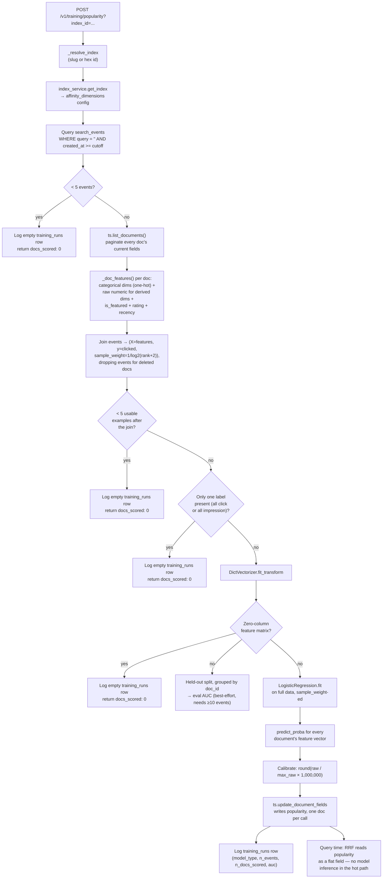

# Popularity Trainer — What's Actually Running (Case A Implementation)

> **Status: Implemented.**
> This documents the real, built pipeline — `services/domain/popularity_trainer.py`
> + `routers/training.py` — as opposed to `docs/trainedRescorerDesign.md`,
> which is the pre-implementation design for all three cases (A/B/C). Read
> that doc for the *why*; read this one for exactly what the code does.

## What this is

A trained replacement for one piece of `analytics_service.aggregate_popularity()`'s
hand-written CTR formula: instead of a fixed `1/log2(rank+2)` decay summed
into a score, a `LogisticRegression` model is trained on real browse
behavior and its calibrated output is written into the same `popularity`
field. It's a separate, decoupled addition — `analytics_service.py` and
`routers/analytics.py` are untouched; this is its own module, its own
router, its own database table.

**Endpoint:** `POST /v1/training/popularity?index_id=<slug-or-id>&days=30`

## What it does, step by step

1. **Resolve the index** (slug or hex id, same `_resolve_index` helper every
   other admin endpoint uses) and pull its stored `affinity_dimensions`
   config — the same categorical/numeric-tier dimensions already computed
   by `affinity_service.discover()` for personalization. No rediscovery, no
   hardcoded field list.

2. **Pull training data**: query `search_events` for this index, filtered
   to `query = ''` (browse-only impressions/clicks) within the lookback
   window. If there are fewer than 5 events, stop here — log an empty
   `training_runs` row and return `docs_scored: 0` rather than trying to
   fit a model on nothing.

3. **Fetch every document's current fields** via `ts.list_documents()` —
   the same call backing `GET /v1/indexes/{id}/documents` — paginated
   across the whole index.

4. **Build one feature dict per document**: every enabled affinity
   dimension's categorical value (one-hot-able), or — for a *derived*
   dimension like `price_tier`/`{field}_tier` — the **raw underlying
   numeric value** (`price`, `sla_hours`, whatever it is), not the bucket.
   Plus `is_featured`, a rating signal when present
   (`averageStarRating × log(1+ratingsCount)`), and a bounded recency
   feature from `indexed_at`. Fields that don't exist for a given catalog
   are just absent from the dict — no per-vertical branching anywhere in
   this code.

5. **Join events to features, weighted by position**: each `search_events`
   row becomes one training example — `clicked` (0/1) as the label, that
   document's feature dict as `X`, and `1/log2(rank+2)` (same decay curve
   `aggregate_popularity` already uses) as the training `sample_weight`.
   Events whose `doc_id` no longer exists in Typesense are dropped here, so
   the 5-event minimum from step 2 is **re-checked against the joined
   example count**, not just the raw query count — a query that clears the
   threshold can still bottom out here if most of its events point at
   deleted docs. If every remaining event has the same label (all clicks or
   all impressions — nothing to learn), stop gracefully too.

6. **Vectorize and train**: `DictVectorizer` turns the mixed
   categorical/numeric feature dicts into a sparse matrix (no pandas
   needed — this is exactly what `DictVectorizer` is for). If every
   document's feature dict came out empty — no affinity dimensions
   discovered yet and none of `is_featured`/rating/`indexed_at` present —
   the matrix has zero columns; that's detected and treated as the same
   "nothing to learn" empty-run case as steps 2 and 5, rather than letting
   `LogisticRegression.fit()` raise. A held-out
   20% split gives a rough AUC when there's enough data (≥10 events); the
   real model is then fit on everything. The split is grouped by `doc_id`
   (`GroupShuffleSplit`), not a plain per-event split — multiple events for
   the same document share an identical feature vector, so a random
   per-event split would let the same doc leak into both train and test and
   inflate the reported AUC.

7. **Score every document** (not just ones with events — the model
   generalizes from features) and **calibrate**: `popularity = round(raw /
   max_raw * 1_000_000)` — identical final normalization to today's
   formula, just fed by the model's predicted probability instead of a
   summed heuristic.

8. **Write back**: `ts.update_document_fields(collection, doc_id,
   {"popularity": ...})` — the exact same call `apply_popularity` already
   uses. Query-time reads this as a flat field; no model inference happens
   in the search hot path.

9. **Log the run** to a new `training_runs` table — index, model type,
   event/doc counts, the held-out metric — so training history is
   queryable, not just the latest overwrite.

## Flow diagram

## Deliberate v1 scope decisions

- **Trained per index, not pooled across indexes.** The longer-term design
  (`trainedRescorerDesign.md`) recommends pooling for data sufficiency;
  this implementation trains one model per index to stay consistent with
  the existing per-index `?index_id=` endpoint shape. Revisit if a
  specific index's traffic proves too sparse to fit anything meaningful.
- **Position-debiasing is the existing decay curve, not IPS/propensity
  correction.** Same limitation the design doc already flags as a
  documented v2 follow-up (`researchTopic1ImplicitFeedbackRanking.md`).
- **Eval is a simple held-out AUC**, not the full offline counterfactual
  (nDCG/MRR) harness — enough to sanity-check the pipeline, not enough to
  claim relevance quality without real production traffic behind it.
- **Derived dimensions use the raw numeric value, not the bucket** —
  e.g. the model sees the actual `price`, not `price_tier`'s
  budget/mid/premium label. Strictly more information for the model;
  also avoids duplicating `context_service.py`'s threshold logic here.

## Verification performed

- `backend/tests/routers/test_training.py` — 6 router-level integration
  tests against a live server process (auth guard, unknown index,
  too-few-events, missing-Typesense-collection resilience, `training_runs`
  logging). These cover routing and the early graceful exits, but never
  reach vectorization, model fitting, calibration, or the Typesense
  write-back — a code-review pass flagged this gap after it let a
  zero-feature-matrix crash ship undetected (see below).
- `backend/tests/domain/test_popularity_trainer.py` — 7 tests calling
  `train_and_apply()` directly against the real Postgres test DB with
  `ts.list_documents`/`ts.update_document_fields` mocked, added to close
  that gap. These drive the full path — vectorization, fit, calibration,
  write-back — and specifically regression-guard the three fixes below:
  a genuinely empty feature matrix, the post-join event-count threshold,
  and the doc-id-grouped held-out split (the last one proven by a case that
  only fails under grouping: 2 doc groups force a single-class side of the
  split, which must degrade to `auc: None` instead of raising).
- All 13 training tests pass alongside the rest of the backend suite (34
  passed; 3 pre-existing, unrelated failures in `test_analytics.py`).
- Live end-to-end run against the Phones index (`22ffabfef4d1`): seeded
  real `search_events`, called the endpoint, confirmed a trained model
  (AUC 0.75 on the tiny seed set) wrote calibrated `popularity` values in
  the correct 0–1,000,000 range and logged a `training_runs` row. The seed
  data and resulting scores were then removed/restored so the live index
  was left in its original state — this was a mechanical pipeline check,
  not a relevance-quality claim.

## What this doesn't do (yet)

Case B (query-conditional boost) and Case C (personalized affinity
weights) are still just design, not code — see `trainedRescorerDesign.md`.
There's no scheduler either; this endpoint is on-demand only, same as
`/v1/analytics/aggregate` — triggering it repeatedly (cron, k8s CronJob,
manual) is an operational decision outside this codebase.
