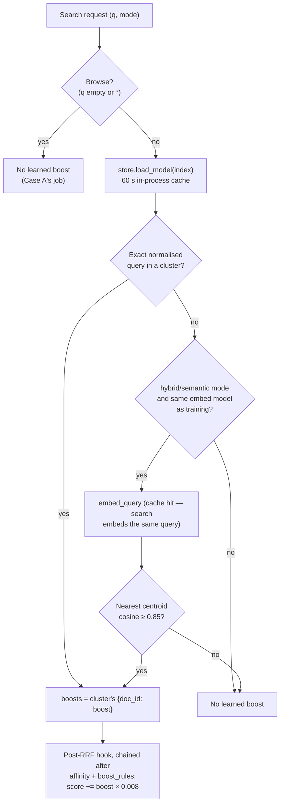

# Learned Query Boost — What's Actually Running (Case B Implementation)

> **Status: Implemented.**
> This documents the built pipeline in `services/domain/query_boost/`, plus
> its routes in `routers/training.py`. `docs/trainedRescorerDesign.md` is the
> pre-implementation design for all three cases; read it for the *why* and
> this doc for what the code does. Case A is documented in
> `docs/popularityTrainerImplementation.md`.

## What this is

Case B learns, from clicks, which documents users actually pick **for a
given kind of query**, and gives those documents a small, bounded lift the
next time a similar query is searched. Case A's `popularity` says "this
item does well in general". Case B says "for *cheap iphone*-type queries,
people click the iPhone SE".

It replaces the idea behind the hand-curated `boost_queries_equal` /
`boost_queries_contains` fields (empty on every Phones document) with a
learned signal. Those curated fields are **not** removed. They stay as
operator merchandising levers.

## Endpoints

| Method | Path | What it does |
|---|---|---|
| `POST` | `/v1/training/query-boost?index_id=<slug-or-id>&days=30` | Train and store the model for one index |
| `GET` | `/v1/training/query-boost?index_id=…` | Inspect the stored model: clusters, member queries, top boosted docs |
| `DELETE` | `/v1/training/query-boost?index_id=…` | Remove the model and turn off the index's schedule. This is the per-index off switch |
| `GET` | `/v1/training/query-boost/schedule?index_id=…` | Read the index's batch-learning schedule, `next_run_at` and the last run's outcome |
| `PUT` | `/v1/training/query-boost/schedule?index_id=…` | Set the schedule: `{"enabled": true, "days": 30, "run_hour_utc": 2}` |

All are admin routes (JWT required), like `/v1/training/popularity`.
An unknown index returns `404`, unlike Case A's `200` + `error` body.
Training runs on demand (`POST`) or on each index's daily schedule (see
[Batch learning schedule](#batch-learning-schedule)). In the UI, both are on
the index's **Learning** tab.

## Code layout (decoupled, one job per module)

| Module | Kind | Job |
|---|---|---|
| `clustering.py` | pure | Normalise queries, group them by intent (embedding cosine), match a live query to a cluster |
| `scoring.py` | pure | Position-weighted clicks per (cluster, doc), shrinkage, boost in `[0, 1]` |
| `store.py` | I/O | Postgres persistence and a 60 s in-process cache |
| `trainer.py` | I/O | Orchestration: events → clusters → boosts → store → `training_runs` |
| `serving.py` | query time | Resolve boosts for a query, build and chain the post-RRF hook |
| `schedule.py` | pure | When a scheduled run is due; next-run time; result → status text |
| `schedule_store.py` | I/O | Postgres persistence for schedules, and the atomic per-run `claim` |
| `scheduler.py` | background | The loop started in the app lifespan that runs due schedules |
| `coordination.py` | I/O | Per-index training lock (Postgres advisory lock) shared by manual and scheduled runs |

Nothing in `analytics_service.py` or `popularity_trainer.py` imports this
package, and it imports neither. Its only touch points with the rest of
the code are the routes, a few lines in each of `routers/search.py` and
`routers/catalog.py`, and the scheduler's start/stop in `main.py`.

## Training, step by step (`trainer.train`)

1. **Resolve the index** and its embedding model (`meta.embed_model` or the
   global default). Search uses the same model, so stored centroids can be
   compared with live query vectors.
2. **Pull query events** from `search_events`: non-empty `query`, within
   the lookback window.
3. **Normalise and filter.** Queries are lower-cased with whitespace
   collapsed. Two kinds are dropped:
   - **Superlative queries** ("cheapest phone", via
     `concept_resolution.detect_superlative_concept`). Those are resolved
     deterministically to a field sort, so their clicks would only echo
     that sort back.
   - **The `*` wildcard**, which is browse and belongs to Case A.

   If fewer than **5** events remain, training stops, **the existing model
   is kept**, and an empty `training_runs` row is logged.
4. **Keep the top 500 distinct queries** by frequency and embed each one
   with `embedding_service.embed_query`. Results are cached, so a query
   already searched for is a cache hit. Embedding runs with 8 calls at a
   time, and a failed call just leaves that query unembedded.
5. **Cluster by intent** (greedy leader clustering, cosine ≥ **0.85**).
   Queries are visited most-frequent first; each joins the most similar
   existing cluster or starts a new one. A query with no embedding becomes
   its own cluster, which is still matchable by exact text at serve time.
6. **Score per (cluster, doc)** (`scoring.compute_boosts`):
   - Impressions and clicks are **separate rows** in `search_events`.
     `/v1/analytics/impressions` writes `clicked=false` rows and
     `/v1/analytics/click` writes its own `clicked=true` row. A click row
     counts as a click only, never as an extra impression. A doc's
     impressions are raised to at least its click count (a click implies it
     was shown), which keeps every CTR within [0, 1].
   - Each event is weighted `w = 1/log2(rank+2)`, the same decay Case A
     uses as its `sample_weight`. Lower ranks were less likely to be seen,
     so their outcomes are trusted less.
   - The cluster baseline is `p_c = Σ clicks_w / Σ impressions_w`.
   - Empirical-Bayes shrinkage gives
     `shrunk = (clicks_w + m·p_c) / (impressions_w + m)`, with `m = 5`.
   - The boost is `max(0, shrunk − p_c) / (1 − p_c)`, in `[0, 1]`. Boosts
     below 0.01 are not stored.
7. **Replace the stored model** in one transaction. **Every cluster is
   stored, including ones that learned no boost.** They act as matching
   boundaries: a query in such a cluster matches it and gets no lift. If the
   cluster were dropped, the query could fall through to a neighbouring
   cluster above the similarity threshold and pick up that cluster's
   boosts. At serve time a known query never falls back to vector matching.
8. **Log** a `training_runs` row: `case_name='B'`,
   `model_type='ctr_shrinkage'`, `metric_name='n_clusters'`.

### "Blend toward Case A when sparse"

The design asked for shrinkage toward Case A's item score rather than a
hard cutoff. With little evidence, `shrunk ≈ p_c`, so the boost is ≈ 0 and
the Case B term vanishes. Ranking then falls back to everything else,
including Case A's `popularity` multiplier, which is applied independently.
That gives the same blend without coupling the two models.

## Serving (`serving.py`)



- **Magnitude.** `score += boost × 0.008`, where 0.008 is about half of
  the #1 RRF score (1/61 ≈ 0.016).
  - The design proposed `boost_queries_*`-sized values (+0.3 to +0.5).
    Those would be about 30× the whole RRF range and would repeat the
    2026-09 "Galaxy fold for *iphone 17*" bug (`docs/scoreBoost.md`).
  - At 0.008, a doc with the strongest evidence can climb from about rank
    30 to the top.
  - It still can't beat `is_featured` (+0.5), `boost_queries_*`
    (+0.3/+0.5) or pinned hits. Operator levers keep winning.
- **Where it applies:**
  - `/v1/indexes/{id}/search`, all modes, including external indexes.
  - `/v1/catalog/search` (PLP). Boosts are resolved per source index and
    keyed `<index_id>:<doc_id>`, because catalog search merges several
    indexes. When one applies, the response lists `learned_query_boost` in
    `context_actions_used`.
- **Lexical mode** matches by exact query text only, so it never pays for
  an embedding. It also only reorders the page Typesense returned, the
  same limit every other post-RRF hook has on the flat lexical path.
- **Exact-title guard.** If any candidate's title or alias equals the
  query (ignoring case and whitespace), the learned boost is skipped for
  the whole request. A boost of just 0.1 adds 0.0008, more than the RRF
  gap between adjacent ranks, so without the guard it could lift
  "iPhone 17 Pro Max" over the exact "iPhone 17". `apply_editorial_boosts`
  has no such guard, so it is enforced here, in `serving.make_hook`.
- **Failure behaviour.** A DB error while loading, or an embedding error
  while matching, means "no boost" and never a failed search.
- **Cache.** Saving or deleting invalidates the cache in the process that
  handled the request. Other API processes pick up the change within 60 s.
- **Consistent reads.** A model load reads both tables in one
  `REPEATABLE READ`, read-only transaction. Cluster ids are reused across
  runs, so a retrain committing between two separate reads could otherwise
  pair the old run's query mapping with the new run's boosts.

## Batch learning schedule

Each index can retrain itself once a day. It's off by default and set per
index on the **Learning** tab or with `PUT …/schedule`:

| Setting | Default | Meaning |
|---|---|---|
| `enabled` | `false` | Daily retraining on or off |
| `days` | 30 | Lookback window for each run (1–365), the same as `POST`'s `days` |
| `run_hour_utc` | 2 | Hour of day, in UTC, the run starts (0–23) |

**When a run happens.** The scheduler checks every 60 s. A run is due
when the most recent `run_hour_utc`:00 UTC (the *slot*):

- is after the schedule was enabled. Turning it on, or changing the hour,
  starts from the next slot, never immediately. Use **Train now** or
  `POST` for an immediate run.
- hasn't been run yet.

If the API was down at the slot, the run happens once on the next check
after it comes back. Several missed days still give one run, because each
run reads the latest `days` of events anyway.

**Several API instances.** Every instance runs the loop. Before
training, an instance claims the run with one conditional `UPDATE`
(`schedule_store.claim`), so exactly one instance trains each slot, with no
Redis lock and nothing stale left after a crash. Set
`TRAINING_SCHEDULER_ENABLED=false` to keep an instance out of scheduling.
Its schedules stay readable and editable.

**Outcome.** Each run records `last_status`:
- `trained`
- `skipped`: not enough traffic; the previous model is kept
- `error`: the exception text goes in `last_message`

A failure on one index doesn't stop the others. Indexes train one at a
time, so the nightly batch doesn't compete with itself for the embedding
provider. Each run also writes a `training_runs` row, as on-demand runs
do. Search picks up the new model within `store.CACHE_TTL_SECONDS`.

**Off switch.** `DELETE /training/query-boost` also turns the schedule off.
Otherwise a nightly run would quietly bring back a model an operator just
removed.

## Concurrency: manual runs, scheduled runs and delete

Two mechanisms, each closing one race:

- **Only one training run per index at a time.** `trainer.train` takes a
  per-index Postgres advisory lock (`coordination.training_lock`) for the
  whole run, so neither the scheduler nor "Train now" can bypass it. A run
  that finds it held doesn't wait:
  - a manual `POST` gets **409**
  - a scheduled run records `skipped` ("another training run … was in
    progress").

  The lock lives on a dedicated direct connection **outside the shared
  pool**. If it held a pool connection while the run borrowed more,
  `max_size` concurrent runs could deadlock the pool and starve search. A
  run therefore holds at most one pool connection at a time. If the
  process dies, the connection closes and Postgres frees the lock, so
  there's no TTL and nothing stale.
- **A delete can't be undone by a run already in flight.**
  `query_boost_generations` holds a per-index counter that every
  `save_model` and `delete_model` bumps. A run reads it before it starts
  and publishes only if it hasn't changed (`save_model(...,
  expected_generation=g)`, checked under `SELECT … FOR UPDATE` in the
  publish transaction). After a delete mid-run, the run's result is
  discarded and it returns `superseded: true`. The deletion stands, and
  `DELETE` itself never waits for training.
- **No scheduled run can publish after a DELETE.** The generation check
  alone isn't enough: a scheduled run that starts *after* the delete reads
  the new generation. So:
  - `DELETE` disables the schedule, bumps the generation and removes the
    model in **one transaction** under the generation row lock
    (`store.delete_model(disable_schedule=True)`).
  - Scheduled runs publish with `require_schedule_enabled`, checked under
    the same lock and with the schedule row share-locked (`FOR SHARE`)
    until commit. A `PUT` turning the schedule off either commits first,
    so the publish sees it and refuses, or waits until the publish has
    committed. It never returns "off" and then has a scheduled model
    appear.

  A scheduled run therefore lands either before the delete, which then
  removes it, or after it, and is refused. Turning a schedule off with `PUT`
  also discards a scheduled run in progress. A *manual* train started after
  a delete is an explicit request and publishes normally.

**Known limit.** If an instance dies mid-run, that slot's status stays
`running` until the next day's run. The run is not retried the same day.
The training lock is released when the connection closes, so manual runs
aren't blocked.

## Schema (`database.init_db`)

```
query_boost_clusters (index_id, cluster_id) PK
    queries TEXT[], centroid DOUBLE PRECISION[], embed_model, trained_at
query_boosts (index_id, cluster_id, doc_id) PK
    boost DOUBLE PRECISION, n_impressions, n_clicks
query_boost_generations (index_id) PK
    generation BIGINT   -- bumped by every save/delete; guards stale publishes
query_boost_schedules (index_id) PK
    enabled, days, run_hour_utc, enabled_at, updated_at,
    last_run_at, last_finished_at, last_status, last_message   -- times: epoch s
```

All four have `ON DELETE CASCADE` from `indexes`. They live in Postgres, not as
a `boost_queries_learned` field on each Typesense document (the design
doc's first idea), for three reasons:

- Serving needs query → cluster before cluster → doc, and the cluster table
  has to live somewhere anyway.
- A whole model is replaced in one transaction, not with N per-document
  Typesense writes.
- Existing collections need no schema change.

## Deliberate v1 scope decisions

- **Promotions only.** A doc shown often and never clicked gets 0, not a
  penalty. Learning demotions is riskier with noisy data, so it's a
  follow-up.
- **Per index**, like Case A. There's no cross-index pooling.
- **Position handling is the decay curve, not IPS.** This is the same
  documented follow-up as Case A.
- **Deleted documents aren't pruned from the model.** A boost for a missing
  doc never meets a candidate set, so checking would cost a full collection
  scan for no ranking effect.
- **Device-compatibility queries aren't filtered out of training.**
  Exact-variant matching (`deviceCompatibilityMatchingDesign.md`) is still
  protected at serve time by the exact-title guard (see Serving), which covers the
  case where the variant's title or alias equals the query.
- **`/v1/content` search** doesn't use post-RRF hooks at all, so it gets no
  learned boost.
- **No offline ranking metric yet** (nDCG/MRR). `training_runs` records the
  cluster count, not a quality metric.

## Tunables

All are module constants, set at code level the same way Case A's are:

| Constant | Default | Effect |
|---|---|---|
| `clustering.DEFAULT_THRESHOLD` | 0.85 | Query-to-cluster cosine, for both training and serving |
| `scoring.DEFAULT_PRIOR_STRENGTH` | 5 | Pseudo-impressions of shrinkage; higher means more data needed |
| `scoring.MIN_STORED_BOOST` | 0.01 | Smallest boost stored |
| `serving.MAX_SCORE_BOOST` | 0.008 | Score added for `boost = 1.0` |
| `trainer.MIN_EVENTS` | 5 | Below this, training is skipped |
| `trainer.MAX_QUERIES` | 500 | Distinct queries embedded per run |
| `store.CACHE_TTL_SECONDS` | 60 | How long other processes may serve a stale model |
| `scheduler.TICK_SECONDS` | 60 | How often the scheduler checks for due runs |
| `TRAINING_SCHEDULER_ENABLED` (env) | `true` | Run the scheduler loop on this instance |

Per-index `days` and run hour are settings, not constants. See
[Batch learning schedule](#batch-learning-schedule).

## Tests

- **`backend/tests/domain/query_boost/`, pure unit tests** (no DB or
  Typesense; run anywhere):
  - `test_clustering.py`: normalisation, cosine, merging and threshold,
    deterministic ordering, exact versus vector matching.
  - `test_scoring.py`: position weight, aggregation (click rows are not
    impressions), shrinkage (sparse
    evidence loses to steady evidence), promotions only, independent
    clusters, `[0, 1]` range.
  - `test_serving.py`:
    - lookup and resolve: exact match without embedding, vector fallback,
      skipped when the embedding model changed, embedding failure gives no
      boost, browse never touches the store
    - hook arithmetic and chaining
    - the exact-title guard: title or alias match suppresses the boost,
      and the same boost does flip adjacent ranks when there is no exact
      match
    - the magnitude guarantees: a strong boost lifts rank 20 to the top,
      and the maximum boost stays below `is_featured`.
  - `test_trainer.py`: orchestration with the I/O boundaries patched (too
    few events keeps the old model, superlative exclusion, paraphrase
    pooling, no-embedding fallback, `MAX_QUERIES` cap, `training_runs`
    logging).
- **`test_schedule.py` and `test_scheduler.py`, pure unit tests:**
  - slot and due-time rules: enabling after today's slot waits for
    tomorrow, missed days give one run, non-UTC `now`, hours 0 and 23
  - next-run text and result-to-status mapping
  - the loop: trains with each schedule's own `days`, skips runs that
    aren't due and runs it lost the claim for, never trains twice in one
    slot, and records a failure without stopping the other indexes.
- **`test_schedule_store.py`** (real Postgres):
  - defaults and round trip
  - `enabled_at` is kept when only `days` changes, reset when the hour
    changes, and cleared when turned off
  - five concurrent claims for one slot: exactly one wins.
- **`test_coordination.py`** (real Postgres) reproduces both races
  deterministically by parking a run mid-training:
  - a model deleted during a run stays deleted, and the run reports
    `superseded`
  - a scheduled run that starts after a delete can't publish (the
    reviewer's interleaving), and neither can one in flight during it or
    during a `PUT` that turns the schedule off
  - a schedule disable that commits while a publish waits on the schedule
    row wins
  - a manual train after a delete still works
  - training completes with a one-connection pool, and five concurrent
    locks leave a one-connection pool usable
  - a second run during the first is `busy`, not overlapping
  - the lock is per index and released on exit or on an exception
  - a publish with a stale generation writes nothing.
- **`backend/tests/domain/query_boost/test_store.py`**: round trip
  (unboosted clusters kept), replace, delete, cache behaviour, and a
  retrain injected mid-load still yielding one consistent snapshot. Runs
  against real Postgres; skipped when `DATABASE_URL` is unset.
- **`backend/tests/routers/test_training_query_boost.py`**: auth, 404,
  too-few-events, and train → inspect → delete against the running server.
  For the schedule endpoints it covers auth, 404, defaults → save → read,
  input validation, `DELETE` turning the schedule off, and **409** when a
  run already holds the index's lock.
- **`frontend/tests/components/sources/LearningTab.helpers.test.ts`**: day
  validation, UTC-to-local hour labels (including half-hour and negative
  offsets), relative times, status pills and result messages. Background
  refresh (`formAfterRefresh`) never overwrites unsaved edits, and a
latest-request gate (`createLatestGate`) drops a poll response that a save
overtook. `LearningTab.test.ts` mounts the component. Leaving the tab
before the first load finishes installs no polling, and a normal unmount
removes both the poll and the visibility listener. `vitest.config.ts`
resolves Svelte's browser build, so `onMount`/`onDestroy` run in component
tests. Train-now
  409 and superseded messages are also covered. The tab re-reads status
  every 30 s and when the tab becomes visible again.

Run the unit tests with:

```
cd backend && uv run --with pytest --with pytest-asyncio python -m pytest tests/domain/query_boost
```
