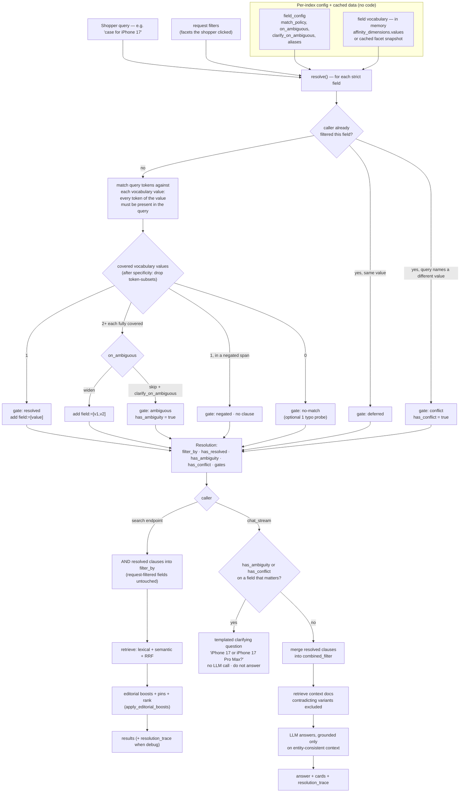

# Schema-Driven Entity Resolution — Config-Only Variant Disambiguation Across Every Index

> **Status: Proposed — not yet implemented. Architecture approved; matching
> algorithm, confidence model, facet validation and filter-conflict semantics
> revised after review (see the revision notes in §2c, §2d, §6, §7.5).**
> Design captured following the "verify before implementing" pattern used
> elsewhere in this project. Every code reference below was checked against the
> current codebase.
>
> **Origin.** Generalizes the deployed, chat-only `_resolve_device_filter`
> (`services/infra/chat/service.py:282`, see `deviceCompatibilityMatchingDesign.md`)
> into an index-agnostic layer, and adopts the "schema is the source of decision
> logic" framing from the *Deterministic Entity Resolution* research paper
> (`docs/research-papers/02-deterministic-entity-resolution.md`). Nothing here is
> per-vertical code — the only thing that differs per index is **config**.
>
> **Core principle (post-review).** The decision source is each strict field's
> **finite, cached vocabulary**, matched against the query *in application code*:
> a vocabulary value is selected only when **every one of its significant tokens
> appears in the query**. Typesense is used for retrieval and (on a miss) for
> typo candidate generation — never to decide which value the shopper named.
> This is what keeps array fields, near-identical values (`pet safe` /
> `not pet safe`) and base-vs-qualified models (`iPhone 17` / `iPhone 17 Pro Max`)
> safe.

---

## 1. Problem

### Variant drift

Retrieval — lexical, semantic, or RRF-blended — returns things that are *similar*
to the query, not necessarily the *entity the shopper named*. For a query that
names a specific value of a discriminating attribute, that is a defect:

| Index | Query | What retrieval returns | What the shopper meant |
|---|---|---|---|
| phones | "does the **Samsung** one fold" | mixes Apple, Google, Samsung | only `manufacturer = samsung` |
| accessories | "case **for iPhone 17**" | cases for 16 / 15 / "iPhone" generally | only `compatible_devices ∋ iPhone 17` |
| plants | "**pet safe** trailing plant" | includes "not pet safe if ingested" | only `pet_safety_label = pet safe` |
| smartwatches | "**Apple** watch with LTE" | Galaxy Watch, Pixel Watch surface too | only `manufacturer = apple` |

In **search** a wrong-variant hit at rank 8 is noise. In **chat** a wrong-variant
doc *inside the LLM context window* is a wrong answer — the model can only ground
on what it was given.

### Why the current fix doesn't generalize

`_resolve_device_filter` solves exactly one case:

- hard-wired to the concept `"device_compatibility"` and the field names
  `compatible_devices` / `compatible_with` (`_CONCEPT_FIELD_CANDIDATES`, line 192);
- only fires when the query contains a digit (`_HAS_NUMBER_RE`);
- lives in `chat_stream`, so `/v1/indexes/{id}/search` never benefits;
- has no notion of *why* it resolved (or didn't) — nothing an operator can inspect.

Adding a second hard-wired concept for `manufacturer`, a third for
`pet_safety_label`, a fourth for `operating_system`… is the pattern the research
paper argues against. The schema already tells us which fields discriminate
entities; we should read it.

---

## 2. The mechanism

Three ingredients, none of them per-index code.

### 2a. Per-field **match policy** (config)

Each entry in an index's existing `field_config` gains optional keys:

```jsonc
{ "name": "manufacturer", "type": "string", "searchable": true, "facet": true,
  "match_policy":         "strict",     // NEW — default "tolerant"
  "on_ambiguous":         "skip",       // NEW — "skip" (default) | "widen"
  "clarify_on_ambiguous": true,         // NEW — chat asks vs leaves broad (default true for identity fields)
  "aliases":              {} }          // NEW — { "phrase": "canonical vocabulary value" }
```

| `match_policy` | Behaviour |
|---|---|
| `tolerant` *(default)* | resolver ignores the field — today's behaviour, zero change |
| `strict` | when the query **names** a value this field can take (every token of that value present — §2d), retrieval is filtered to it (`field:=[value]`), which for a single-value field inherently *excludes* contradicting variants — the paper's "strict field" and "contradiction gate" in one clause |

`on_ambiguous` — the query names **two+** values that are *each* fully covered
(`"s25 ultra or s25 edge"`): `skip` (default) or `widen` to `field:=[a,b]`.

**`strict` is validated on write** (§7.1): the field must be a Typesense
`string` / `string[]` with `facet: true` and a bounded vocabulary. The PATCH
endpoint returns an actionable error rather than silently changing the schema.

Set in the **Fields tab** — same PATCH endpoint (`routers/indexes.py` →
`FieldUpdate`) that already toggles `searchable` / `facet` / `chat`.

### 2b. Field **vocabulary** comes from the data, not a hand-list

For a `strict` field, the resolver needs to know which values it can take. ISP
already computes this per index:

- **`affinity_service.discover()`** runs after every rebuild and stores
  `affinity_dimensions[].values` on the index row — the enumerated vocabulary for
  each categorical field, cached, free.
- For a `strict` field not in `affinity_dimensions`: one Typesense facet query
  (`ts.get_facet_fields` + `facet_by`), cached on the index row alongside the
  dimensions.

Real vocabularies today:

| Index | `strict` field | Vocabulary (from `affinity_dimensions`) |
|---|---|---|
| phones | `manufacturer` | `apple, google, motorola, samsung, sonim, t-mobile®` |
| phones | `operating_system` | `android, ios, kaios, other` |
| phones | `form_factor` | `flip, fold, standard` |
| accessories | `category` | `cases-&-covers, chargers-&-adapters, headphones, screen-protectors, simcard` |
| accessories | `compatible_devices` | `iPhone 17, iPhone 17 Pro Max, Galaxy S25 Ultra, …` (from `device_compatibility_accessories.js`) |
| plants | `pet_safety_label` | `pet safe, not pet safe, unknown` |
| plants | `growth_style` | `climbing, compact, trailing, upright, other` |
| plants | `plant_family` | `alocasia, calathea, dracaena, fittonia, …` |
| smartwatches | `manufacturer` | `apple, google, samsung, t-mobile®` |
| smartwatches | `operating_system` | `android, watchos, wear os` |

### 2c. One shared `resolution_service` (code, written once)

`services/domain/resolution_service.resolve(index_meta, query, request_filters) -> Resolution`:

```text
for each field where match_policy == "strict":
    if the caller already filtered this field (request_filters)  → gate "deferred", skip
    vocab   = cached vocabulary for the field                    (§2b, in-memory, no I/O)
    matched = vocabulary values the query VERIFIABLY names        (§2d)
      0 values  → gate "no-match"
      1 value   → gate "resolved"  → add clause  field:=[value]
      2+ values → gate "ambiguous" (query named a family / two things)
                    on_ambiguous: skip  → no clause
                    on_ambiguous: widen → add clause  field:=[v1,v2]
    (a negated span for this field → gate "negated", no clause — see §2d)

return Resolution(
    filter_by      = resolved clauses joined with " && ",
    has_resolved   = any gate resolved,
    has_ambiguity  = any strict field ambiguous and unresolved,
    has_conflict   = query text names a value that contradicts a request filter,
    gates          = the full per-field trace)
```

**Confidence is not one scalar** — the caller reads the independent flags
(`has_resolved` / `has_ambiguity` / `has_conflict`) and decides. A field resolving
does not silence an ambiguity on another field (§6).

No strict fields, or an empty query → returns immediately, **zero Typesense
calls**. Vocabulary is read from cache; Typesense is used only for optional
typo-fuzzing of query tokens (§2d), never as the decision source.

Called from **both** entry points — one code path, every index:

- `routers/search.py::_run_search` — merge `Resolution.filter_by` into `ts_filter`
  (respecting request-filter precedence, §2e).
- `services/infra/chat/service.py::chat_stream` — merge into `combined_filter`;
  if `has_ambiguity` or `has_conflict` on a field that matters, ask a clarifying
  question instead of answering (§6).

### 2d. How a value is matched — vocabulary-first, deterministic

> **Revised after review.** The earlier draft extracted whole field values from
> whatever documents matched the query, which conflates *"a document matched"*
> with *"the query named this value"* — unsafe for array fields
> (`compatible_devices: ["iPhone 17", "iPhone 17 Pro", "iPhone 16 Pro"]`) and for
> near-identical values (`"pet safe"` vs `"not pet safe"`). The decision source is
> now the **finite cached vocabulary**, matched in application code.

For each `strict` field the resolver holds the complete list of values that field
can take (§2b — from `affinity_dimensions[].values` or a cached facet query). It
then decides, deterministically:

```python
def match_field(query: str, vocab: list[str], cfg: dict) -> MatchResult:
    q_tokens = _significant_tokens(_norm(query), drop=cfg.get("stopwords", []))
    #          lower-case, strip, collapse ws; drop configured non-discriminating words

    candidates = []
    for value in vocab:
        v_tokens = _significant_tokens(_norm(value))
        # every significant token of the VALUE must be present in the query
        # (each token may match a query token exactly or within 1 edit)
        if v_tokens and all(_token_present(vt, q_tokens) for vt in v_tokens):
            span = _covered_span(v_tokens, q_tokens)          # which query tokens this value used
            candidates.append((value, v_tokens, span))

    if not candidates:
        # optional fallback: one Typesense probe of just this field for pure-typo
        # cases ("samsng foldable"); still verified with the same all-tokens rule
        candidates = _typo_fallback(query, field=cfg["name"], vocab=vocab)

    if not candidates:
        return MatchResult(outcome="no-match")

    # specificity: drop any value whose token set is a strict subset of another
    # covered value's token set — "iPhone 17" is dropped when "iPhone 17 Pro Max"
    # is also fully covered by the query
    winners = _most_specific(candidates)

    # negation: if the covered span sits inside a negated region of the query
    # ("not ...", "non-", "without", "avoid ..., "unsafe for ...") → don't resolve
    if any(_span_is_negated(w.span, query) for w in winners):
        return MatchResult(outcome="negated", candidates=[w.value for w in winners])

    if len(winners) == 1:
        return MatchResult(outcome="resolved", value=[winners[0].value])
    return MatchResult(outcome="ambiguous", candidates=[w.value for w in winners])
```

Key rule: **every significant token of a vocabulary value must appear in the
query** for that value to be a candidate. Not "the query matched a document that
has this value."

#### Walk-throughs

**`"does the samsung one fold"` — phones**

| Field | vocab | candidates (all tokens present in query?) | winner | outcome |
|---|---|---|---|---|
| `manufacturer` | apple, google, motorola, **samsung**, sonim, t-mobile® | `samsung` ⊆ query ✓ ; others ✗ | `samsung` | **resolved** |
| `form_factor` | flip, **fold**, standard | `fold` ⊆ query ✓ | `fold` | **resolved** |
| `operating_system` | android, ios, kaios, other | none | — | no-match |
| `category` | handset, simcard | none | — | no-match |

→ `manufacturer:=[samsung] && form_factor:=[fold]`, `has_resolved=true`, no ambiguity.

**`"case for iPhone 17"` — accessories, `compatible_devices` is `string[]`**

Vocabulary (distinct across the catalog): `iPhone 17`, `iPhone 17 Pro`,
`iPhone 17 Pro Max`, `iPhone 16 Pro`, `Galaxy S25 Ultra`, …

| vocab value | tokens | all present in query `{case, iphone, 17}`? |
|---|---|---|
| `iPhone 17` | {iphone, 17} | ✓ |
| `iPhone 17 Pro` | {iphone, 17, pro} | ✗ (no *pro*) |
| `iPhone 17 Pro Max` | {iphone, 17, pro, max} | ✗ |
| `iPhone 16 Pro` | {iphone, 16, pro} | ✗ |

One candidate → **resolved: `compatible_devices:=[\`iPhone 17\`]`**. The
co-listed `iPhone 17 Pro` / `iPhone 16 Pro` on the matching document are
**never pulled in** — only the value the query actually covered. `category` also
resolves (`case` → `cases-&-covers`). The digit-narrowing heuristic is gone.

**`"pet safe trailing plant"` — plants, polarity**

| vocab value | tokens | all present in `{pet, safe, trailing, plant}`? |
|---|---|---|
| `pet safe` | {pet, safe} | ✓ |
| `not pet safe` | {not, pet, safe} | ✗ — *not* is absent |
| `unknown` | {unknown} | ✗ |

→ **resolved: `pet_safety_label:=[\`pet safe\`]`**. `"not pet safe"` is excluded
precisely because its token *not* is not in the query. `growth_style` resolves
`trailing`. The design's integration test ("zero *not pet safe* docs") holds.

**`"not pet safe" / "plants unsafe for cats"` — negation**

`pet safe` and `not pet safe` are both token-covered by `"not pet safe …"`.
Specificity picks `not pet safe`; the covered span sits in a negated region →
**outcome `negated`, no clause added**. Result: broad retrieval, `has_resolved=false`.
(Deliberately conservative — a shopper typing a negation has murky intent;
better to show everything than to guess the polarity.)

**`"screen protector for galaxy s25"` — genuine ambiguity vs false ambiguity**

- If `Galaxy S25` **is** a standalone vocabulary value → its tokens `{galaxy, s25}`
  are covered, `Galaxy S25 Ultra` needs *ultra* (absent) → one winner →
  **resolved** to `Galaxy S25`.
- If the vocabulary only has the variants (`S25 Ultra`, `S25+`, `S25 Edge`, `S25 FE`)
  and none is fully covered → **no-match**, broad results.
- Only if two+ variants are *each* fully covered ("s25 ultra or s25 edge") is it
  genuinely **ambiguous**.

Retrieval returning five S25-ish documents is no longer mistaken for "the query
named five values."

#### Typo tolerance

`_typo_fallback` runs one `query_by`-scoped Typesense search for the field **only
when the in-memory pass found nothing**, then re-applies the same all-tokens rule
to the returned candidate values. `"samsng foldable"` → Typesense offers
`samsung` / `fold` as fuzzy candidates → verified → resolved. Word order and
plurals ("17 pro max", "foldables") are handled by token-set matching, not the
raw string.

#### `aliases` (per-field config)

A field may carry `"aliases": {"iphone seventeen": "iPhone 17", "galaxy": "samsung"}`
— applied during normalization so `"the galaxy that folds"` can resolve
`manufacturer=samsung`. Aliases are the explicit tuning knob for vocabulary gaps;
nothing is inferred.

#### Cost

Vocabulary matching is pure in-memory Python (a few hundred short string
comparisons) — **no Typesense call**. `_typo_fallback` fires only on a miss, and
batches across the missed fields into one `multi_search`. Common queries that
name a value cleanly cost **zero extra round trips**; the worst case (all strict
fields miss the in-memory pass) is one.

### 2e. Request filters take precedence over inferred filters

`_run_search` already builds a `filter_by` from `req.filters` — the facets the
shopper clicked. The resolver must not fight those:

| Situation | Policy |
|---|---|
| Caller already filtered field **F** (e.g. facet `manufacturer=Apple`) | resolver **does not probe F** — gate `deferred`. The explicit choice wins. |
| Query text names a **different** value for F ("Samsung foldable" while `manufacturer=Apple` is faceted) | `has_conflict = true`; F stays as the caller set it; a `conflict` entry is written to the trace. Search: honour the facet (no surprise zero-results). Chat: surface it — *"You've filtered to Apple, but you asked about Samsung — which did you want?"* |
| Query names a value for a field the caller did **not** filter | normal resolution |

The resolver never emits `field:=[a] && field:=[b]` for the same field — that is
the "zero results, unexplained" failure the review flagged.

---

## 3. Flow



---

## 4. Per-index configuration — worked

Config lives on the index; the code is identical for all of them.

### phones

```jsonc
"field_config": [
  { "name": "manufacturer",     "match_policy": "strict", "on_ambiguous": "widen" },
  { "name": "operating_system", "match_policy": "strict" },
  { "name": "form_factor",      "match_policy": "strict" },
  { "name": "category",         "match_policy": "strict" }   // handset vs simcard
]
```

| Query | Resolves | `filter_by` |
|---|---|---|
| "does the samsung one fold" | `manufacturer = samsung` | `manufacturer:=[samsung]` |
| "cheapest android phone" | `operating_system = android` | `operating_system:=[android]` (+ superlative sort, existing) |
| "foldable" | `form_factor = fold` | `form_factor:=[fold]` |
| "iphone 17" | *nothing* — "iphone"/"17" aren't `manufacturer`/`os`/`form_factor` values | — (falls through to normal retrieval + exact-match protection) |
| "samsung or apple flagship" | `manufacturer ∈ {samsung, apple}` (widen) | `manufacturer:=[samsung,apple]` |

### accessories

```jsonc
"field_config": [
  { "name": "compatible_devices", "match_policy": "strict" },   // multi-value → array-contains
  { "name": "category",           "match_policy": "strict" },
  { "name": "manufacturer",       "match_policy": "tolerant" }  // accessory brand rarely the intent
]
```

| Query | Resolves | `filter_by` |
|---|---|---|
| "case for iphone 17" | `compatible_devices = iPhone 17` (Pro/Pro Max not token-covered), `category = cases-&-covers` | `compatible_devices:=[\`iPhone 17\`] && category:=[cases-&-covers]` |
| "screen protector s25 ultra" | `compatible_devices = Galaxy S25 Ultra`, `category = screen-protectors` | … |
| "usb-c cable" | `category = chargers-&-adapters` | `category:=[chargers-&-adapters]` |

`_resolve_device_filter` becomes one instance of the generic path and is deleted.
Its digit-narrowing heuristic is **replaced**, not generalized: specificity now
falls out of the all-tokens rule — `"iPhone 17"` covers the value `iPhone 17`;
`iPhone 17 Pro Max` is not a candidate because *pro*/*max* are absent from the
query (§2d).

### plants

```jsonc
"field_config": [
  { "name": "pet_safety_label", "match_policy": "strict" },
  { "name": "growth_style",     "match_policy": "strict" },
  { "name": "care_difficulty",  "match_policy": "strict" },
  { "name": "plant_family",     "match_policy": "strict" }
]
```

| Query | Resolves | `filter_by` |
|---|---|---|
| "pet safe trailing plant" | `pet_safety_label = pet safe`, `growth_style = trailing` | `pet_safety_label:=[\`pet safe\`] && growth_style:=[trailing]` |
| "easy calathea" | `care_difficulty = easy`, `plant_family = calathea` | … |
| "beginner plant for low light" | `care_difficulty = beginner` | `care_difficulty:=[beginner]` (light handled by facet/semantic) |

`pet_safety_label` as a **strict** field is the highest-value case in this
catalog — "pet safe" is a hard constraint a shopper will not forgive getting
wrong, and semantic retrieval happily returns "not pet safe if ingested" for
"pet safe" because the strings are 80% identical.

### smartwatches

```jsonc
"field_config": [
  { "name": "manufacturer",     "match_policy": "strict" },
  { "name": "operating_system", "match_policy": "strict" }
]
```

| Query | Resolves | `filter_by` |
|---|---|---|
| "apple watch with lte" | `manufacturer = apple` | `manufacturer:=[apple]` |
| "wear os watch" | `operating_system = wear os` | `operating_system:=[\`wear os\`]` |

### plans — the null case

`plans` is sitemap-crawled: `field_config` has only `title`, `url`, `metadata`
(SEO tags), **no structured attributes, 0 affinity dimensions**. No field is
marked `strict` → `resolve()` returns an empty `Resolution` → retrieval is
completely unchanged. **An index with nothing to resolve costs nothing.** This is
the property that makes the feature safe to ship on by default.

---

## 5. The resolution trace

Every `resolve()` call produces a structured trace — the paper's "decision trace,
in terminology catalogue managers understand," which ISP has never had:

```jsonc
{
  "query": "case for iphone 17",
  "index": "accessories",
  "has_resolved": true, "has_ambiguity": false, "has_conflict": false,
  "gates": [
    { "field": "compatible_devices", "outcome": "resolved", "value": ["iPhone 17"],
      "covered_tokens": ["iphone", "17"],
      "rejected": { "iPhone 17 Pro": "token 'pro' absent from query",
                    "iPhone 16 Pro": "tokens 'pro','16' absent" } },
    { "field": "category", "outcome": "resolved", "value": ["cases-&-covers"],
      "covered_tokens": ["case"] },
    { "field": "manufacturer", "outcome": "no-match" }
  ],
  "filter_by": "compatible_devices:=[`iPhone 17`] && category:=[cases-&-covers]",
  "excluded_estimate": 47   // docs the filter removed from the candidate set
}
```

The `rejected` map is the key diagnostic — it names *why each near-match
vocabulary value was not selected*, in the shopper's own words.

- **Search:** returned in the response body when `SearchRequest.debug == true`;
  a "Why these results?" panel in the search debug UI.
- **Chat:** attached to the SSE `done` event; optionally a one-line user-facing
  grounding hint ("Showing accessories for **iPhone 17**").
- **Both:** written to a small `resolution_events` table (query, index, the three
  flags, gate outcomes, filter, timestamp) → feeds the analytics panel in §10 and
  makes "why did the bot recommend the wrong thing" answerable after the fact.

---

## 6. Escalation — independent state, not one confidence scalar

> **Revised after review.** A single `confidence` collapsed too much: if
> `manufacturer` was ambiguous but `form_factor` resolved, `confidence` came out
> `high` and chat answered with the brand still unconstrained.

`Resolution` exposes three independent booleans plus the per-field gates:

| Flag | Set when |
|---|---|
| `has_resolved` | ≥1 strict field produced a clause |
| `has_ambiguity` | ≥1 strict field is `ambiguous` **and unresolved** — the query named a family or two things and `on_ambiguous=skip` |
| `has_conflict` | query text names a value that contradicts a caller-supplied request filter (§2e) |

Per field, `field_config` also carries `clarify_on_ambiguous: bool` (default
`true` for identity-ish fields like `manufacturer` / `compatible_devices`,
`false` for a broad one like `category` where broad results are acceptable).

### What each caller does

| | Search | Chat |
|---|---|---|
| `has_resolved`, no ambiguity/conflict | apply `filter_by` | apply, answer |
| `has_ambiguity` on a `clarify_on_ambiguous` field | apply the *resolved* clauses, leave the ambiguous field open (broad within it) | **ask a clarifying question** for that field, do not answer yet — even if another field resolved |
| `has_ambiguity` only on non-clarify fields | apply resolved clauses | apply, answer (broad results are fine here) |
| `has_conflict` | honour the request filter, add a trace note | surface the contradiction, ask which the shopper meant |
| nothing resolved | unchanged retrieval | unchanged retrieval |

The clarifying question is **templated from the ambiguous gate's `candidates`** —
no LLM call:

> *"There's an iPhone 17 and an iPhone 17 Pro Max — which did you mean?"*

Chat already has follow-up detection (`_T1_RE`) and multi-turn state; the next
turn re-runs `resolve()` with the disambiguated query.

---

## 7. Implementation plan

### 7.1 Config plumbing (`models/index.py`, `routers/indexes.py`)

`field_config` entries today are `{name, facet, multi_value, searchable}` (see
`models/index.py:213`). Add:

```python
# field_config entry — all optional, defaults preserve today's behaviour
"match_policy":         "strict" | "tolerant"      # default "tolerant"
"on_ambiguous":         "skip"   | "widen"         # default "skip"
"clarify_on_ambiguous": bool                       # default True for identity fields, False for broad ones
"aliases":              { "phrase": "canonical vocabulary value", ... }   # default {}
```

**`match_policy="strict"` is validated on write.** The PATCH endpoint
(`routers/indexes.py` → `FieldUpdate`) rejects it unless the field:

- is a Typesense `string` or `string[]` type, **and**
- has `facet: true` (a `filter_by` clause needs a facetable field), **and**
- has a non-empty bounded vocabulary (§7.2).

If `facet` is off, the operator gets an actionable error
(*"Enable faceting on `manufacturer` before marking it strict"*) — the endpoint
does **not** silently mutate the schema.

**No migration** — a `field_config` without these keys is a valid "all tolerant"
config; `resolve()` on such an index does nothing.

### 7.2 Field vocabulary — the decision source

`resolve()` matches the query against the field's **finite vocabulary**, held in
memory (§2d). It never extracts values from retrieval hits.

```python
async def _field_vocabulary(index_meta: IndexMeta, field: str) -> list[str]:
    # 1. affinity_dimensions already carries values[] for most categorical fields,
    #    refreshed after every rebuild by affinity_service.discover_and_save
    for dim in index_meta.affinity_dimensions or []:
        if dim.get("field") == field and dim.get("values"):
            return [str(v) for v in dim["values"]]
    # 2. otherwise a cached facet snapshot on the index row — same write-through
    #    pattern as superlative_field_map (models/index.py:222)
    cached = (index_meta.resolution_vocab or {}).get(field)
    if cached is not None:
        return cached
    values = await _facet_values(index_meta.id, field)           # one facet query, q=*
    await index_service.set_resolution_vocab(index_meta.id, field, values)
    return values
```

- **Refreshed on rebuild** and on `affinity_service.discover_and_save`. Also
  refreshable without a full rebuild via `POST /v1/indexes/{id}/fields/{name}/refresh-vocab`
  (a single facet query) so a data-only ingest that adds a new brand doesn't
  leave the vocabulary stale.
- **Bounded** — reject `strict` on a free-text field where the facet returns
  hundreds of near-unique values; that field isn't an entity discriminator.
- `_typo_fallback` (§2d) still issues at most one `query_by`-scoped Typesense
  search, but only to *generate candidate strings* on an in-memory miss — the
  same all-tokens verification then runs against them.

### 7.3 The module (`services/domain/resolution_service.py`, ~250 lines)

```python
from dataclasses import dataclass, field

@dataclass
class Gate:
    field: str
    outcome: str            # resolved | no-match | ambiguous | negated | deferred | conflict
    value: list[str] = field(default_factory=list)
    candidates: list[str] = field(default_factory=list)
    reason: str = ""

@dataclass
class Resolution:
    filter_by: str = ""
    has_resolved: bool = False
    has_ambiguity: bool = False        # unresolved ambiguity on a clarify_on_ambiguous field
    has_conflict: bool = False
    gates: list[Gate] = field(default_factory=list)

    def trace(self, query, index):
        return {"query": query, "index": index,
                "has_resolved": self.has_resolved, "has_ambiguity": self.has_ambiguity,
                "has_conflict": self.has_conflict, "filter_by": self.filter_by,
                "gates": [g.__dict__ for g in self.gates]}


async def resolve(index_meta, query: str, request_filters: dict[str, list[str]] | None = None
                  ) -> Resolution:
    strict = [f for f in (index_meta.field_config or [])
              if f.get("match_policy") == "strict"]
    if not strict or not query.strip():
        return Resolution()                                   # null path — zero cost, zero I/O

    request_filters = request_filters or {}
    r = Resolution()
    typo_misses: list[dict] = []

    for f in strict:
        name = f["name"]

        # §2e — caller already constrained this field: don't touch it
        if name in request_filters:
            named = _match_field(query, _vocab(index_meta, name), f)   # detect a conflicting value
            if named.outcome == "resolved" and set(named.value) != set(request_filters[name]):
                r.has_conflict = True
                r.gates.append(Gate(name, "conflict", value=named.value,
                                    reason=f"request filter = {request_filters[name]}"))
            else:
                r.gates.append(Gate(name, "deferred", reason="request filter set"))
            continue

        m = _match_field(query, _vocab(index_meta, name), f)           # §2d, in-memory
        if m.outcome == "need-typo-probe":
            typo_misses.append(f); continue
        _apply_gate(r, f, m)

    if typo_misses:                                          # one multi_search for the misses only
        for f, m in await _typo_probe(index_meta.id, query, typo_misses):
            _apply_gate(r, f, m)

    return r


def _apply_gate(r: Resolution, f: dict, m: "MatchResult") -> None:
    name = f["name"]
    if m.outcome == "resolved":
        r.filter_by = _and(r.filter_by, _build_clause(f, m.value))
        r.has_resolved = True
        r.gates.append(Gate(name, "resolved", value=m.value))
    elif m.outcome == "ambiguous":
        if f.get("on_ambiguous", "skip") == "widen":
            r.filter_by = _and(r.filter_by, _build_clause(f, m.candidates))
            r.has_resolved = True
            r.gates.append(Gate(name, "resolved", value=m.candidates, reason="widened"))
        else:
            if f.get("clarify_on_ambiguous", True):
                r.has_ambiguity = True
            r.gates.append(Gate(name, "ambiguous", candidates=m.candidates))
    elif m.outcome == "negated":
        r.gates.append(Gate(name, "negated", candidates=m.candidates))
    else:
        r.gates.append(Gate(name, "no-match"))


# ── matching (§2d) ──────────────────────────────────────────────────────────
def _match_field(query, vocab, cfg) -> "MatchResult":
    q = _apply_aliases(_norm(query), cfg.get("aliases", {}))
    q_tokens = _significant_tokens(q, drop=cfg.get("stopwords", []))

    covered = []
    for value in vocab:
        v_tokens = _significant_tokens(_norm(value))
        if v_tokens and all(_token_present(vt, q_tokens) for vt in v_tokens):
            covered.append((value, frozenset(v_tokens)))

    if not covered:
        return MatchResult("need-typo-probe")               # in-memory miss → optional fuzzy pass

    winners = _most_specific(covered)                        # drop token-subsets of another winner
    if any(_span_negated(w, query) for w in winners):
        return MatchResult("negated", candidates=[w[0] for w in winners])
    if len(winners) == 1:
        return MatchResult("resolved", value=[winners[0][0]])
    return MatchResult("ambiguous", candidates=[w[0] for w in winners])


def _build_clause(cfg, values) -> str:
    name = cfg["name"]
    quoted = ",".join("`" + v.replace("\\", "").replace("`", "") + "`" for v in values)
    return f"{name}:=[{quoted}]"        # `:=` covers scalar and string[]; backticks/backslashes stripped
```

Helpers left to the implementation: `_norm`, `_significant_tokens` (lower/strip/
collapse + drop configured non-discriminating words), `_token_present` (exact or
≤1 edit against any query token), `_most_specific`, `_span_negated` (checks for
`not` / `non-` / `without` / `avoid` / `un…-for` around the covered tokens),
`_typo_probe` (one `query_by`-scoped `multi_search` for the missed fields,
candidate values re-verified with the same all-tokens rule), `_and`, `_vocab`
(wraps §7.2, memoised per request).

### 7.4 Search integration (`routers/search.py::_run_search`)

```python
# after ts_filter is built from req.filters, before search_with_vec / search_documents
if not meta.is_external and _has_strict_fields(meta):
    resolution = await resolution_service.resolve(meta, req.q, request_filters=req.filters)
    if resolution.filter_by:
        ts_filter = _and(ts_filter, resolution.filter_by)   # §2e guarantees no same-field clash
    if req.debug:
        _resolution_trace = resolution.trace(req.q, meta.id)
```

- `SearchRequest` gains `debug: bool = False`; `resolution_trace` appears in the
  body only when `debug=True` — no shape change for existing callers.
- `request_filters=req.filters` is what makes §2e work: a field the shopper
  faceted is never re-inferred; a text/facet contradiction is traced, not merged.
- Ranking is downstream and untouched — `apply_editorial_boosts`, pinned
  re-assertion and exact-match protection run on whatever survives the filter.

### 7.5 Chat integration (`services/infra/chat/service.py::chat_stream`)

> **Revised after review.** The earlier draft folded the resolution probes into
> `chat_stream`'s retrieval `multi_search`. That doesn't work: `resolve()` must
> finish *before* `combined_filter` is known, and that filter feeds
> `_search_context()` — one sub-search can't rewrite a sibling's `filter_by` in
> the same request. **v1: one resolution step, then retrieval.** Optimise only
> if traces show the round trip mattering.

```python
resolution = await resolution_service.resolve(index_meta, search_query,
                                              request_filters=_filters_from(combined_filter))

if resolution.has_ambiguity or resolution.has_conflict:
    yield {"type": "text", "content": _clarify(resolution)}          # templated, no LLM call
    yield {"type": "done", "resolution_trace": resolution.trace(search_query, index_id)}
    return

combined_filter = _combine_filters(combined_filter, resolution.filter_by)
# … existing retrieval + LLM path, now on entity-consistent context …
```

- `_clarify(resolution)` — templated from the first `ambiguous` gate's
  `candidates`, or from the `conflict` gate (*"You've filtered to Apple but asked
  about Samsung — which did you want?"*). Zero LLM tokens.
- Most in-memory resolutions add **no Typesense call at all**; a miss adds one
  `multi_search` before retrieval — negligible next to the LLM turn.
- **Delete** `_resolve_device_filter` and `_CONCEPT_FIELD_CANDIDATES["device_compatibility"]`.
  `_SUPERLATIVE_RE` / `_extract_price_filter` stay (numeric/orderable — separate).

### 7.6 Optional: cache the `Resolution`

Search queries repeat. Cache `resolve()` output per `(index_id, vocab_version,
_norm(query))` in Redis, short TTL, same client the embedding cache uses. Bump
`vocab_version` on rebuild / vocab refresh. Skip for v1 unless traces show it's
needed — in-memory matching is already cheap.

### 7.7 Rollout phases

| Phase | Scope | Gate to next |
|---|---|---|
| **1** | `resolution_service` (vocab-first matcher, independent flags), config keys + **PATCH facet validation**, `search.py` integration, unit tests. **Ship with every field `tolerant`** — code path live, zero behaviour change. | full unit suite green incl. polarity / array-field / specificity / conflict cases; no latency regression |
| **2** | Mark `strict` on **one** index (phones: `manufacturer`, `form_factor`). **Shadow mode** — log the resolution trace, do *not* apply `filter_by`; diff would-be vs live top-10 across the query regression set. | trace review: correct resolutions, zero false narrowing, negation queries → `negated`/`no-match` |
| **3** | Apply on phones. Add accessories — migrate `_resolve_device_filter`; a regression test asserts the new path produces the same or a *stricter* filter for the current device-variant test queries. | existing device-variant chat `test_*` pass on the new path |
| **4** | Chat clarifying question on `has_ambiguity` / `has_conflict`; plants (`pet_safety_label` — watch polarity) + smartwatches; **delete** `_resolve_device_filter`. | polarity integration test green: `"pet safe"` → zero `not pet safe` docs |
| **5** | Fields-tab UI (match-policy dropdown + alias editor); resolution-health analytics panel; vocab-refresh endpoint. | — |

### 7.8 Files touched

| File | Change |
|---|---|
| `services/domain/resolution_service.py` | **new** — §7.3 (vocab-first matcher, `MatchResult`, `Gate`, `Resolution`) |
| `models/index.py` | `field_config` keys `match_policy` / `on_ambiguous` / `clarify_on_ambiguous` / `aliases`; new `resolution_vocab: dict = {}` column |
| `models/search.py` | `SearchRequest.debug: bool = False` |
| `services/domain/index_service.py` | `set_resolution_vocab(idx, field, values)` — mirrors `set_affinity_dimensions` |
| `routers/indexes.py` | `FieldUpdate` accepts the new keys **with strict-field validation** (string type + `facet:true` + bounded vocab); `POST .../fields/{name}/refresh-vocab`; clear `resolution_vocab` in `discover_and_save` |
| `routers/search.py::_run_search` | call `resolve(meta, req.q, request_filters=req.filters)`, merge `filter_by`, attach trace on `debug` |
| `services/infra/chat/service.py` | replace `_resolve_device_filter` block with `resolve()` before retrieval; `has_ambiguity`/`has_conflict` → clarifying question; **delete** `_resolve_device_filter` + `_CONCEPT_FIELD_CANDIDATES["device_compatibility"]` |
| `services/infra/database.py` | `ALTER TABLE indexes ADD COLUMN IF NOT EXISTS resolution_vocab` (idempotent block) |
| `frontend/src/components/sources/FieldsTab.svelte` | match-policy dropdown + per-field alias editor; inline error when `strict` set on a non-faceted field |
| Analytics dashboard | resolution-health panel (§10) |

---

## 8. Non-goals

- **Not a ranker.** `resolve()` only narrows the candidate set (a Typesense
  `filter_by`). Ranking is untouched — `apply_editorial_boosts`, pinned
  re-assertion and exact-match protection run as now on whatever survives.
- **Not fuzzy taxonomy inference.** It matches the query against a field's own
  vocabulary values, token-for-token. It will not decide that "phablet" means
  `form_factor=fold` — that is what per-field `aliases` are for, explicitly.
- **Not a hard entity classifier.** No ML, no labelled data. Deterministic
  all-tokens-present matching against a finite cached vocabulary.
- **Not sentiment / intent analysis.** A negated span suppresses resolution
  (`negated` gate); it does not try to infer whether the shopper wants the
  negative value.
- **Not for numeric/orderable intent.** "cheapest", "under $500", "newest" stay
  with the existing `_SUPERLATIVE_RE` / `_extract_price_filter` path.

---

## 9. Testing

Follow the existing convention (`backend/tests/`, real Postgres + live server,
`seed_events`-style helpers).

### Unit — `_match_field` (the matcher)

1. query names exactly one value → `resolved`, correct `field:=[\`value\`]`
2. query names no value → `no-match` → `need-typo-probe`
3. **array field, co-listed values** — doc `compatible_devices = ["iPhone 17","iPhone 17 Pro","iPhone 16 Pro"]`, query `"case for iphone 17"` → resolves **only** `iPhone 17`; the co-listed values are never emitted
4. **base vs qualified** — `"iphone 17"` → `iPhone 17` (not Pro/Pro Max); `"iphone 17 pro max"` → `iPhone 17 Pro Max` (specificity drops `iPhone 17`)
5. **overlapping vocabulary** — `"galaxy s25"` with vocab `{Galaxy S25, Galaxy S25 Ultra, …}` → resolves `Galaxy S25` only (Ultra needs *ultra*, absent)
6. **overlapping vocabulary, family only** — same query, vocab has *only* the variants → `no-match` (broad), not false-`ambiguous`
7. **genuine ambiguity** — `"s25 ultra or s25 edge"` → `ambiguous`, candidates `[Galaxy S25 Ultra, Galaxy S25 Edge]`
8. **polarity** — `"pet safe"` → `pet safe` only (`not pet safe` needs token *not*); `"pet friendly"` alias → same
9. **negation** — `"not pet safe"`, `"non-toxic"`, `"avoid pet-safe plants"`, `"plants unsafe for cats"` → `negated`, no clause
10. `on_ambiguous=widen` → `field:=[a,b]`, `has_resolved=true`
11. **aliases** — `"the galaxy that folds"` with `aliases:{galaxy: samsung}` → `manufacturer=samsung`
12. typo — `"samsng foldable"` → `need-typo-probe` → `_typo_probe` → verified → `resolved`
13. **unknown spelling equally close to two values** → `ambiguous` (or `no-match` under the typo threshold), never an arbitrary pick
14. vocab value with backtick / bracket / comma / backslash → correctly escaped in the clause
15. empty / stale / truncated vocabulary → `no-match`, never a crash

### Unit — `resolve` (orchestration)

16. index with no strict fields → empty `Resolution`, all flags false, **zero Typesense calls**
17. **partial ambiguity** — `manufacturer` ambiguous (`clarify_on_ambiguous=true`) + `form_factor` resolves → `has_resolved=true` **and** `has_ambiguity=true`; `filter_by` has the `form_factor` clause only
18. ambiguity on a `clarify_on_ambiguous=false` field → `has_ambiguity=false`
19. **request-filter precedence** — caller filters `manufacturer=apple`, query says nothing about brand → `manufacturer` gate `deferred`, no clause added for it
20. **request-filter conflict** — caller filters `manufacturer=apple`, query `"samsung foldable"` → `has_conflict=true`, no `manufacturer:=[…]` emitted, `conflict` gate in trace
21. never emits `field:=[a] && field:=[b]` for the same field
22. trace shape fixture-locked

### Integration — per index (phones, accessories, plants, smartwatches)

23. phones `"does the samsung one fold"` → `manufacturer:=[samsung] && form_factor:=[fold]`; only Samsung folds retrieved
24. accessories `"case for iphone 17"` → filter is same-or-stricter than the current `_resolve_device_filter` output for every existing device-variant test query
25. **plants polarity** `"pet safe trailing"` → **zero** `not pet safe` docs in results
26. plants `"not pet safe"` → broad results (negation → no filter)
27. plans (no strict fields) → results byte-identical to pre-change
28. **valid resolution, zero hits** — a filter that legitimately matches nothing returns an empty result set with the trace explaining why (not an error)
29. **pinned / featured under a resolution filter** — a pinned doc excluded by the filter is *not* forced back in; a pinned doc that passes stays pinned
30. `debug=true` → response carries `resolution_trace` with per-gate outcomes
31. **vocab refresh** — add a new `manufacturer` value via data-only ingest, hit `refresh-vocab`, the new value resolves without a full rebuild

### Chat

32. `has_ambiguity` on a clarify field → clarifying question emitted (templated, no LLM call), no answer generated
33. `has_conflict` → contradiction surfaced, no answer generated
34. clean resolution → contradicting-variant doc absent from the LLM context window
35. existing device-variant chat `test_*` pass against the new path (post `_resolve_device_filter` deletion)

---

## 10. Follow-ups (evidence-gated)

- **Relevance tiers** (`queryAwareGroupPopularityPlan.md`) — orthogonal; tiers
  protect partial/semantic matches, resolution removes contradicting ones. They
  compose.
- **Review queue** — persist `ambiguous` / `conflict` / `negated` gates for a
  human to inspect and turn into `aliases` / vocabulary fixes. The paper's
  controlled-review branch, made durable.
- **Auto-suggest `strict` fields** — after `affinity_service.discover()`, flag
  faceted categorical fields with a small bounded low-overlap vocabulary as
  candidates and let the operator confirm, instead of hand-marking each.
- **`match_strategy` per field** — the default is "all significant tokens
  present + most-specific"; a field could opt into `longest_phrase` (contiguous
  span) or `exact_value_only` if the token rule proves too loose on its data.
- **Verified span in the trace** — record *which* query characters each resolved
  value covered, so the analytics panel can show overlap / gaps at a glance.
- **Cross-field contradiction** — a phones query naming a Samsung *model token*
  (matched by lexical retrieval, not a `manufacturer` vocabulary value) while
  `manufacturer=apple` is faceted → surface as a soft conflict.

---

## References

- `docs/research-papers/02-deterministic-entity-resolution.md` — the schema-derived framing
- `docs/deviceCompatibilityMatchingDesign.md` — the chat-only predecessor this generalizes
- `docs/superlativePriceDesign.md` — the sibling deterministic-query mechanism (numeric/orderable)
- `docs/scoreBoost.md` — ranking layer this sits in front of (unchanged by this design)
- `docs/queryAwareGroupPopularityPlan.md` — the complementary relevance-tier work
