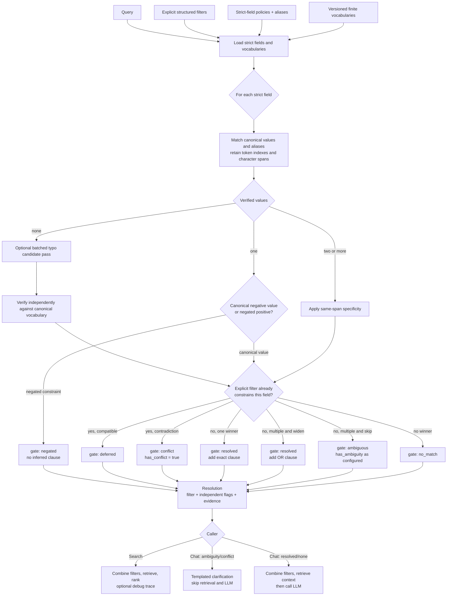
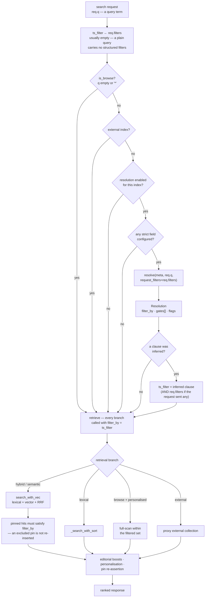
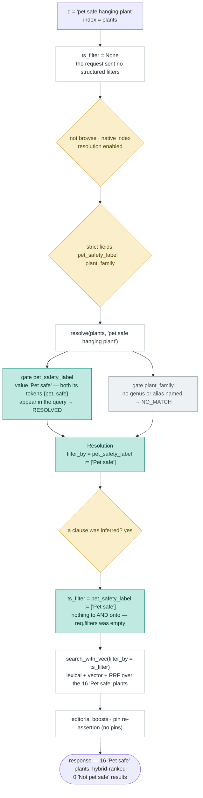

# Schema-Driven Entity Resolution V2

> **Status:** Attempted, then reverted (2026-09) — device-vocabulary matching
> broke on a real query (`"s25 plus"`), and the category-conjunction case
> this was meant to help with is now handled instead by
> `multiIntentConjunctionSearchDesign.md`'s data-driven approach (live
> catalog queries, no hardcoded device vocabulary — see that doc's §18 for
> the fuller history). The reverted code is stashed (`stash@{0}` on
> `chore/somefixes`), not deleted, in case the general (non-conjunction)
> variant-disambiguation problem this document addresses is revisited later.
>
> **Supersedes:** `schemaDrivenEntityResolutionDesign.md` for new implementation
> work. The original document remains as design history.
>
> **Purpose:** Add deterministic, schema-configured variant disambiguation to ISP
> search and chat without embedding product-category logic in backend code.

---

## 1. Objective

Lexical, semantic, and RRF retrieval find related documents. They do not guarantee
that the documents belong to the exact commercial variant named by the shopper.

Examples:

| Query | Unsafe related result | Required constraint |
|---|---|---|
| `iPhone 17 case` | iPhone 17 Pro case | `compatible_devices = iPhone 17` |
| `Samsung foldable` | Google foldable | `manufacturer = samsung` |
| `pet safe trailing plant` | not-pet-safe plant | `pet_safety_label = pet safe` |
| `Apple watch with LTE` | Galaxy Watch LTE | `manufacturer = apple` |

V2 inserts a deterministic resolver before retrieval:

```text
query + explicit filters + per-field policy + finite vocabulary
                              |
                              v
                    verified field constraints
                              |
                              v
              Typesense lexical / semantic / RRF retrieval
```

The resolver narrows retrieval only when the query verifiably names a configured
catalog value. Uncertainty does not become a hard filter.

---

## 2. Design principles

1. **Vocabulary values are the decision source.** Retrieval hits never determine
   which value the query named.
2. **Category behavior is configuration.** Backend code implements matching
   strategies; field configuration selects them and supplies aliases.
3. **Exact canonical values win.** This includes negative values such as
   `not pet safe`.
4. **Matching retains evidence spans.** Token indexes and character offsets are
   required for negation, conflict handling, and traces.
5. **Explicit request filters take precedence.** Inferred filters never contradict
   a shopper-selected facet.
6. **Ambiguity and conflict are independent of successful resolutions.** Resolving
   one field cannot hide uncertainty in another.
7. **Failure is conservative.** Missing, stale, or unrecognized vocabulary yields
   no inferred clause, not an arbitrary selection.
8. **No configured strict fields means no behavior change and no resolver I/O.**

---

## 3. Per-field configuration

Each `field_config` entry may include:

```jsonc
{
  "name": "compatible_devices",
  "type": "string[]",
  "facet": true,
  "match_policy": "strict",
  "match_strategy": "all_tokens",
  "on_ambiguous": "skip",
  "clarify_on_ambiguous": true,
  "normalize_units": false,
  "max_vocab_values": 500,
  "aliases": {
    "iphone seventeen": "iPhone 17"
  },
  "stopwords": []
}
```

### 3.1 Configuration fields

| Key | Values | Default | Meaning |
|---|---|---|---|
| `match_policy` | `tolerant`, `strict` | `tolerant` | Whether the resolver may constrain this field |
| `match_strategy` | `all_tokens`, `longest_phrase`, `exact_value` | `all_tokens` | How canonical values are recognized |
| `on_ambiguous` | `skip`, `widen` | `skip` | Whether multiple explicitly named values form an OR filter |
| `clarify_on_ambiguous` | boolean | `true` | Whether chat stops to clarify an unresolved ambiguity |
| `normalize_units` | boolean | `false` | Whether equivalent compact/spaced unit forms such as `46mm` and `46 mm` are normalized |
| `max_vocab_values` | positive integer | `RESOLUTION_MAX_VOCAB_VALUES` | Per-field vocabulary limit, allowing bounded high-cardinality fields to opt into a larger reviewed cap |
| `aliases` | phrase-to-value map | `{}` | Explicit language-to-canonical-value mappings |
| `stopwords` | string array | `[]` | Non-discriminating tokens ignored for this field |

Defaults are literal and category-independent. ISP must not infer that a field is
“identity-like” from its name.

### 3.2 Write-time validation

Setting `match_policy=strict` is accepted only when:

- the Typesense type is `string` or `string[]`;
- the field has `facet=true`;
- a complete, non-empty vocabulary snapshot exists;
- the vocabulary contains no more than the field's `max_vocab_values`, whose
  default is `RESOLUTION_MAX_VOCAB_VALUES` (`250`);
- every alias target exists in the canonical vocabulary;
- configuration values are valid enum members.

The endpoint returns an actionable `400` response and never silently mutates the
Typesense schema.

---

## 4. Vocabulary lifecycle

### 4.1 Sources

For each strict field, vocabulary resolution order is:

1. `affinity_dimensions[].values`, when present and complete.
2. `resolution_vocab[field]`, populated by a facet snapshot.

The facet query uses `q=*`, `facet_by=<field>`, and requests one value beyond the
field's configured maximum. If more than the maximum exists, the field is rejected
as unbounded instead of caching a silently truncated vocabulary. Operators may set
a larger reviewed `max_vocab_values` for legitimately bounded fields such as
`compatible_devices`, which can exceed 250 values. The cap remains explicit so a
free-text field cannot accidentally become a strict vocabulary.

### 4.2 Loading

Request-time matching is synchronous after one explicit asynchronous preload:

```python
strict_fields = _strict_fields(index_meta)
if not strict_fields or not query.strip():
    return Resolution()

vocabs = await load_vocabularies(index_meta, strict_fields)
return resolve_loaded(index_meta, query, request_filters, vocabs)
```

Normal requests do not write vocabulary data. Strict-policy activation ensures a
snapshot exists first.

The common path performs zero I/O: `load_vocabularies` is async only because it
supports a defensive cache-miss path. Values in `affinity_dimensions` and
`resolution_vocab` are already present on `index_meta` and are returned directly
without a database or Typesense call.

### 4.3 Refresh and invalidation

Vocabulary is refreshed:

- after a full rebuild;
- after affinity rediscovery;
- explicitly through
  `POST /v1/indexes/{id}/fields/{name}/refresh-vocab` after data-only ingestion.

Each successful refresh increments `vocab_version`. A future resolution cache must
include `(index_id, vocab_version, normalized_query, normalized_request_filters)`
in its key.

---

## 5. Matching model

### 5.1 Evidence objects

Matching must retain position rather than reducing the query to a token set:

```python
@dataclass(frozen=True)
class CoveredValue:
    value: str
    source: str                 # canonical | alias | typo
    query_token_indexes: tuple[int, ...]
    char_start: int
    char_end: int
    exact_phrase: bool = False
```

```python
@dataclass
class MatchResult:
    outcome: str                # resolved | ambiguous | negated | no_match
    values: list[str] = field(default_factory=list)
    evidence: list[CoveredValue] = field(default_factory=list)
    reason: str = ""
```

### 5.2 Normalization

Normalization is shared by queries, vocabulary values, and aliases:

- Unicode normalization and case folding;
- punctuation-to-token-boundary conversion;
- whitespace collapse;
- compact/spaced unit normalization (`46mm` ↔ `46 mm`) only when
  `normalize_units=true` for the field;
- no stemming or semantic synonym inference.

The normalized representation retains a map back to original character offsets.

### 5.3 Matching order

For each strict field:

1. Find contiguous exact canonical phrases.
2. Apply configured aliases and record the alias span.
3. Apply the field's configured strategy to remaining canonical values.
4. Keep positional evidence for every covered value.
5. Apply specificity.
6. Apply polarity and negation rules.
7. Classify the result as resolved, ambiguous, negated, or no-match.
8. Optionally perform typo candidate generation only when steps 1–7 produce no
candidate.

Specificity is strategy-dependent: it performs the substantive subset selection
for `all_tokens`, is normally redundant for `longest_phrase`, and acts only as a
defensive tie-break for `exact_value` or alias collisions.

### 5.4 Strategies

#### `all_tokens`

Every significant token of a canonical value must map to a query token. Token
order is not required, but evidence positions are retained. Exact matching is the
default; edit-distance matching is allowed only in the typo pass.

#### `longest_phrase`

Requires a contiguous normalized phrase and selects the longest covered canonical
value. Useful when vocabulary values overlap heavily.

#### `exact_value`

Only an exact normalized canonical value or configured alias appearing as a
contiguous, token-boundary-delimited span in the query is accepted; the whole query
does not need to equal the value. Thus `case for iPhone 17` can match the exact
value span `iPhone 17`. Substrings inside larger tokens and non-contiguous token
sets do not qualify. This strategy is useful for short or collision-prone values.

### 5.5 Specificity

When one covered canonical value is wholly contained in another covered value on
the same query span, retain the more specific value:

```text
query:   iphone 17 pro max
covered: iPhone 17, iPhone 17 Pro, iPhone 17 Pro Max
winner:  iPhone 17 Pro Max
```

For `iphone 17`, qualified values are not candidates because `pro` and `max` are
absent. The resolver selects only `iPhone 17` if that standalone value exists.

Values covered by separate spans are not collapsed. For example,
`S25 Ultra or S25 Edge` remains a genuine multi-value expression.

### 5.6 Aliases are required for taxonomy mappings

The matcher does not infer category semantics. These examples require config:

```jsonc
{
  "name": "category",
  "aliases": {
    "case": "cases-&-covers",
    "phone case": "cases-&-covers",
    "screen protector": "screen-protectors",
    "usb-c cable": "chargers-&-adapters"
  }
}
```

Likewise, `foldable -> fold` must be an alias on `form_factor`. Token matching alone
does not establish those relationships.

Aliases are deliberate operational data, not a one-time setup task. Operators must
maintain colloquial and category-specific phrases as shopper language and catalogs
change. Shadow traces should expose repeated no-match phrases, and a later workflow
may suggest aliases from observed catalog/query evidence for operator approval;
aliases are never activated automatically.

### 5.7 Negative canonical values and negation

An exact canonical value has precedence over generic negation handling:

| Query | Vocabulary | Outcome |
|---|---|---|
| `pet safe plant` | `pet safe`, `not pet safe` | resolve `pet safe` |
| `not pet safe plant` | same | resolve `not pet safe` |
| `plants unsafe for cats` | alias `unsafe for cats -> not pet safe` | resolve `not pet safe` |
| `exclude pet-safe plants` | no negative canonical phrase covered | `negated`, no clause |

Words beginning with `non-` are not automatically treated as negative intent.
Their meaning must be captured by an alias or canonical vocabulary value.

### 5.8 Typo fallback

Typesense may generate candidate values after deterministic matching misses, but
retrieval documents remain non-authoritative:

1. Run one batched, field-scoped `multi_search` for missed strict fields.
2. Extract candidate strings.
3. Intersect them with the cached canonical vocabulary.
4. Compare each candidate independently with the query using a configured typo
   threshold.
5. Resolve only a unique best candidate separated from the runner-up by a defined
   margin; otherwise return ambiguous or no-match.

Array co-values are never accepted merely because they occur on the same document.

### 5.9 Known limitation: under-specified queries

An under-specified query such as `case for the new iPhone` may cover no complete
`compatible_devices` value. The result is `no_match`, not `ambiguous`, because the
query did not verifiably name two or more catalog values. Search and chat therefore
continue with broad retrieval and chat does not automatically clarify. This is
intentional: inferring a generation or turning a family mention into a set of
variants is taxonomy/intent inference and remains a non-goal. A future separately
configured family-level policy could add that behavior without weakening strict
value resolution.

---

## 6. Request-filter precedence and conflicts

An explicit filter supplied by the caller always remains authoritative.

For every strict field already present in `request_filters`, the resolver still
matches query text for diagnostics but emits no clause for that field.

```python
named_values = set(match.values)
filtered_values = set(request_filters[field])
contradictions = named_values - filtered_values

if contradictions:
    gate = "conflict"
else:
    gate = "deferred"
```

This applies to resolved and ambiguous query matches.

| Request filter | Query | Result |
|---|---|---|
| Apple | `foldable watch` | defer manufacturer |
| Apple | `Samsung watch` | conflict: Samsung |
| Apple | `Apple or Samsung watch` | partial conflict: Samsung |

Search honors the explicit filter and reports the conflict only in debug output.
Chat asks which constraint the shopper wants before retrieval.

---

## 7. Resolution result

```python
@dataclass
class Gate:
    field: str
    outcome: str                # resolved | ambiguous | negated | no_match | deferred | conflict
    values: list[str] = field(default_factory=list)
    conflicting_values: list[str] = field(default_factory=list)
    evidence: list[CoveredValue] = field(default_factory=list)
    reason: str = ""

@dataclass
class Resolution:
    filter_by: str = ""
    has_resolved: bool = False
    has_ambiguity: bool = False
    has_conflict: bool = False
    gates: list[Gate] = field(default_factory=list)
```

The flags are independent. A resolved `form_factor` does not hide an ambiguous
`manufacturer`.

`has_ambiguity` is set only for an unresolved ambiguous gate whose field has
`clarify_on_ambiguous=true`.

### 7.1 Clause construction

Clause construction must use one shared Typesense filter serializer. It must:

- validate field names against the in-memory `field_config` or an already cached
  schema snapshot, never fetch the Typesense schema while building a clause;
- escape values rather than deleting arbitrary characters;
- generate deterministic field and value ordering;
- support scalar `string` and array `string[]` equality/containment correctly.

Do not build filters using ad hoc interpolation at multiple call sites.

### 7.2 End-to-end flow



---

## 8. Search integration

In `routers/search.py::_run_search`, immediately after the explicit `filter_by`
string (`ts_filter`) is assembled from `req.filters`, and before any retrieval:

```python
_resolution_trace: dict | None = None
_res_mode = getattr(meta, "resolution_mode", "enforce")   # off | shadow | enforce

if not meta.is_external and not is_browse and _res_mode != "off":
    from isp.services.domain import resolution as _res
    if _res.has_strict_fields(meta):                       # no strict fields → zero-cost no-op
        async def _facet_values(index_id: str, field: str) -> list[str]:
            values, _complete = ts.facet_values(index_id, field)
            return values                                  # request-time fallback; activation guarantees the snapshot

        _resolution = await _res.resolve(
            meta, req.q,
            request_filters=req.filters or {},
            facet_values=_facet_values,
        )
        if _resolution.filter_by and _res_mode == "enforce":
            ts_filter = (f"({ts_filter}) && ({_resolution.filter_by})"
                         if ts_filter else _resolution.filter_by)
        if req.debug or _res_mode == "shadow":
            _resolution_trace = {**_resolution.trace(req.q, meta.id), "mode": _res_mode}

# ... every retrieval branch is called with filter_by=ts_filter ...

if _resolution_trace is not None and isinstance(raw, dict):
    raw["resolution_trace"] = _resolution_trace
```

Resolution runs before lexical, semantic, or RRF retrieval. Existing ranking,
editorial boosts, and personalization operate only on surviving candidates.

Pinned and featured documents must satisfy the resolution filter. In the hybrid
path (`typesense_client.search_with_vec`), a pinned id that is not already in the
candidate set is re-fetched through ``(filter_by) && id:=`<pid>` `` — so a pinned
document the resolution filter excludes cannot be forced back in by pin handling.
The pin re-assertion (`pin_base = max(scores) + 10`) then reorders only the pins
that survived the filter.

The three modes:

| `resolution_mode` | resolver runs | `filter_by` combined | trace emitted |
|---|---|---|---|
| `off` | no | no | no |
| `shadow` | yes | **no** | always (carries `"mode":"shadow"`) |
| `enforce` (default) | yes | yes, when `_resolution.filter_by` is non-empty | only when `req.debug` |

Set per index with `PUT /v1/indexes/{id}/resolution-mode {"mode": …}`.

Browse queries (`""` or `"*"`) bypass resolution entirely, as do external indexes.

### 8.1 Runtime filter flow



The common case is a bare query term with **no** explicit filters: `req.filters`
is `{}`, `ts_filter` starts empty, and `resolution.filter_by` becomes the whole
filter. The request-filter precedence path (gate `deferred` / `conflict`, §6)
only engages when a facet UI sent structured filters alongside the query — today
only the admin search console does; the PLP search box does not.

"Resolution enabled" is `resolution_mode != off`. In `shadow` the resolver runs
and the trace is returned but the clause is **not** combined; in `enforce` (the
default) it is. `req.debug` adds the `resolution_trace` to the response in any
mode. Neither changes the functional path above — see §8 and §10.

The resolver itself is pure and decoupled: `routers/search.py` injects the
`facet_values` lookup; `resolution/` imports nothing from routers, search,
chat, or `typesense_client`. For the per-field decision logic inside
`resolve()` (match → polarity → specificity → request-filter check → gate), see
§7.2.

### 8.2 Worked trace

`q = "pet safe hanging plant"` on the `plants` index, no request filters:



Baseline for the same query without resolution: 2 of the top 5 were
`Not pet safe` (Tradescantia). See §5.7 for why `"plant that is not pet safe"`
resolves to `['Not pet safe']` instead — the value is a canonical negative.

---

## 9. Chat integration

Resolution and retrieval are sequential in v1 because the resolution filter must
exist before `_search_context()` is called:

```python
resolution = await resolution_service.resolve(
    index_meta,
    search_query,
    request_filters=chat_request_filters,
)

if resolution.has_conflict or resolution.has_ambiguity:
    yield clarification_event(resolution)
    yield done_event(resolution)
    return

combined_filter = combine_filters(combined_filter, resolution.filter_by)
cards, context = await _search_context(..., price_filter=combined_filter)
```

`chat_stream` receives request filters as structured data
(`dict[str, list[str]]`) if a chat client supports facets. It must not reverse-parse
the Typesense `combined_filter` string. The current PLP chat widget does not send
facet filters, so `chat_request_filters` is `{}` on that path and search remains
the primary source of request-filter conflicts. If chat facets are added, the
router threads their structured representation through `chat_stream`; filter
serialization occurs only after resolution.

Clarifications are templated from gate evidence and do not require an LLM call.
The next user turn is resolved normally using the updated query/history.

The current `_resolve_device_filter` remains until equivalent behavior is proven
in shadow mode. It is deleted only when accessories migrate to V2.

---

## 10. Trace and observability

### 10.1 Initial rollout

The initial rollout returns an in-memory trace only when search `debug=true` and on the chat SSE
`done` event. The trace includes:

- field and outcome;
- canonical values considered;
- verified query spans;
- match source (`canonical`, `alias`, or `typo`);
- ambiguity or conflicting values;
- generated filter.

The initial rollout does not calculate `excluded_estimate`; doing so would require additional
counting work and is not necessary for resolution correctness.

### 10.2 Later analytics phase

Persistent `resolution_events` and dashboards are a separate rollout phase. That
phase must define:

- database migration and persistence service;
- raw-query redaction or hashing policy;
- retention and deletion policy;
- sampling rate;
- analytics endpoints and UI;
- latency and false-narrowing metrics.

Until those decisions are approved, raw shopper queries are not persisted by this
feature.

---

## 11. Implementation sequence

### Phase 1 — configuration and matcher

- Add validated config fields to `FieldUpdate` and `field_config`.
- Add `resolution_vocab` and `vocab_version` to index metadata/storage.
- Implement vocabulary refresh and loading.
- Implement the pure matcher and filter serializer.
- Ship with all existing fields `tolerant`.

Gate: unit suite passes; no behavior change on current indexes.

### Phase 2 — search shadow mode  *(implemented)*

- `resolution_mode` column (`off | shadow | enforce`) on `indexes`;
  `PUT /v1/indexes/{id}/resolution-mode`.
- In `shadow`, the resolver runs and the trace is always attached to the
  response (`"mode":"shadow"`) but `filter_by` is **not** combined — live results
  are unchanged.
- Compare live and would-be top results against a query regression set.

Gate: no confirmed false narrowing and acceptable latency.

### Phase 3 — search enforcement  *(implemented; live on `accessories`, `plants`)*

- Apply verified filters (`mode: enforce`).
- `accessories.compatible_devices` strict, `on_ambiguous: widen`.
- `plants.pet_safety_label` + `plants.plant_family` strict, `on_ambiguous: widen`.
  `care_difficulty` left tolerant — its single-token `moderate` value collides
  with `"moderate light/water"` queries (matcher step 1 matches single-token
  values regardless of stopwords).
- Verify base/qualified device behavior and multi-valued compatibility fields.
- Pinned/featured documents excluded by the filter must not reappear (§8).

### Phase 4 — chat enforcement

- Add clarification for conflicts and configured ambiguities.
- Migrate accessories from `_resolve_device_filter`.
- Enable selected plant and smartwatch fields.
- Delete the old device-specific resolver only after regression parity.

### Phase 5 — operator UI and analytics

- Add match policy, strategy, alias, ambiguity, and vocabulary controls.
- Suggest recurring unmatched phrases as alias candidates for operator approval;
  never activate inferred aliases automatically.
- Add persistent sampled events only after privacy/retention approval.
- Add resolution health metrics and review workflow.

---

## 12. Files expected to change

| File | Change |
|---|---|
| `backend/src/isp/services/domain/resolution_service.py` | New resolver, matcher, evidence types |
| `backend/src/isp/models/index.py` | Resolution config documentation, `resolution_vocab`, `vocab_version` |
| `backend/src/isp/models/search.py` | `debug: bool = False` |
| `backend/src/isp/services/domain/index_service.py` | Vocabulary snapshot/version updates |
| `backend/src/isp/routers/indexes.py` | Config validation and refresh-vocabulary endpoint |
| `backend/src/isp/routers/search.py` | Pre-retrieval resolution and debug trace |
| `backend/src/isp/services/infra/typesense_client.py` | Shared safe filter serialization/helper if kept in infra |
| `backend/src/isp/services/infra/chat/service.py` | Pre-retrieval resolution and clarification flow |
| Chat router/request models | Optional structured request filters threaded to `chat_stream`; no filter-string parsing |
| `backend/src/isp/services/infra/database.py` | Idempotent vocabulary/version columns |
| `frontend/src/components/sources/FieldsTab.svelte` | Policy, strategy, aliases, validation feedback |

Persistent event storage and the analytics UI are intentionally omitted until
Phase 5 is designed.

---

## 13. Required tests

### Matcher

1. `iPhone 17` resolves the base value, not Pro or Pro Max.
2. `iPhone 17 Pro Max` selects the most specific value.
3. A multi-valued document cannot introduce co-listed vocabulary values.
4. `S25 Ultra or S25 Edge` is genuinely ambiguous or widened by policy.
5. `foldable -> fold` works only through its configured alias.
6. `case -> cases-&-covers` works only through its configured alias.
7. `pet safe` resolves the positive canonical value.
8. `not pet safe` resolves the exact negative canonical value.
9. `unsafe for cats` resolves only when configured as an alias.
10. A genuine negated positive constraint returns `negated` without a clause.
11. Repeated query tokens retain the correct evidence span.
12. Equally plausible typo candidates never cause an arbitrary selection.
13. Missing or stale vocabulary fails safely.
14. Alias targets outside the vocabulary are rejected on write.
15. Special characters are correctly serialized in Typesense filters.
16. `exact_value` matches a complete token-boundary span inside a longer query,
    but not a substring inside a larger token.
17. With `normalize_units=true`, `46mm` and `46 mm` resolve identically; with it
    disabled, no unit rewrite occurs.
18. The default vocabulary cap rejects an oversized field, while an explicit
    reviewed per-field cap accepts the complete snapshot.

### Orchestration

19. No strict fields means zero resolver I/O.
20. Resolved and ambiguous fields can coexist in one result.
21. Explicit filters suppress inferred clauses for the same field.
22. Resolved and ambiguous contradictions are both detected.
23. Clause and trace ordering is deterministic.
24. Browse requests bypass resolution.

### Integration

25. Phone manufacturer/form-factor filters constrain lexical and vector passes.
26. `iPhone 17 case` excludes Pro-only and Pro-Max-only compatibility records.
27. `pet safe trailing` returns no `not pet safe` records.
28. `not pet safe` returns only the negative canonical category when configured.
29. Pinned documents cannot bypass a resolution filter.
30. Debug responses include stable evidence spans and gate outcomes.
31. Vocabulary refresh exposes a newly ingested canonical value.
32. Chat conflict/ambiguity emits clarification and skips the LLM call.
33. Chat receives structured filters without parsing a Typesense filter string.
34. Existing device-resolution tests pass before the old resolver is deleted.

---

## 14. Non-goals

- Learned entity matching or taxonomy inference.
- Numeric range and superlative intent, which remain in the existing price/sort
  path.
- Replacing ranking, editorial boosts, or personalization.
- Automatically deciding which catalog fields are commercially important.
- Persisting shopper queries before an explicit observability/privacy design.

---

## 15. Acceptance criteria

V2 is ready for production enforcement on an index only when:

- every enabled strict field passes schema and vocabulary validation;
- aliases used by documented examples exist in index configuration;
- alias ownership and a review cadence are assigned for every enforced index;
- shadow evaluation finds no confirmed false narrowing in the approved regression
  set;
- ambiguity and filter conflicts are visible in traces;
- all retrieval paths, including vector search and pinned results, honor the same
  inferred filters;
- the old device-specific resolver has regression parity before removal;
- p95 resolver latency remains within the agreed budget.
