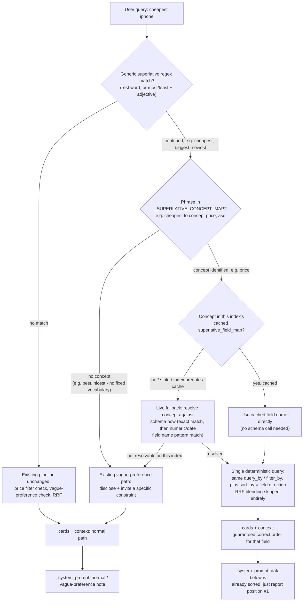

# Superlative Queries — Deterministic "Cheapest" / "Fastest" / "Newest" Handling

> **Status: Implemented**, and extended beyond the original sort-only scope
> (§7–§8 below) to also cover **filter** concepts — "cheapest **military**
> plan" — and to make the concept→field mapping operator-configurable rather
> than resolved only by heuristic or a direct database edit.
>
> Revised from an earlier price-only draft: hardcoding "cheapest"/"most
> expensive" alone repeats the exact narrowness already generalized away from
> once this session (`_RELATIVE_PRICE_RE` → `_RELATIVE_TERM_RE`). This version
> splits **detecting a superlative** (generic, linguistic) from **mapping it to
> a real field** (schema-dependent, one small table, extensible one line at a
> time) — so it isn't just a "cheapest" fix, it's a mechanism for any
> orderable attribute a catalog happens to have.
>
> Revised again after two follow-up questions, both folded in below: (1) field
> *names* aren't universal even when the *concept* is ("price" vs. a service
> catalog's "monthly_cost") — the map now resolves a **concept**, not a
> literal field name, per index; (2) resolving that concept shouldn't require
> a live schema call on every chat request — cached on the index's own row,
> with a live fallback for indexes whose cache hasn't caught up yet.
>
> **Correction from the original design**: §3 below described resolution as
> "precomputed once at rebuild time." What actually shipped resolves lazily —
> on the first chat request that needs a given concept on a given index — and
> write-through caches the result from then on; there is no rebuild-time
> precompute step. Functionally equivalent for a chat request (the common
> case still never hits a live schema call), but the trigger is "first use,"
> not "after rebuild." See §7 for the operator-configurable alternative.

## Problem

"Cheapest iphone" was tested live against the Phones index and failed in two
independent ways, both traced directly from `docker logs isp-api`:

1. **Retrieval never resolves the superlative to a real price sort.**
   `_extract_price_filter` only parses explicit numeric patterns ("under $X,"
   "between $X and $Y") — nothing recognizes "cheapest." So the query falls
   back to ordinary lexical+facet+semantic RRF blending on the literal text,
   which surfaced iPhone 15/16/16 Plus/17/Air — **missing the actual cheapest
   iPhone in the catalog, the 17e at $599.99, entirely.**
2. **Even among the 5 iPhones it *did* retrieve, the LLM picked the wrong one.**
   Its own context contained {$629.99, $829.99, $729.99, $829.99, $1399.99}.
   The minimum is obviously $629.99 (iPhone 15). The model answered iPhone Air
   — **$1,399.99, the most expensive of the five** — as "the cheapest."

So this isn't one bug, it's a retrieval gap compounded by a model reasoning
failure on data it was actually given. Fixing only one side leaves the other
exposed.

## Why not fix this with an LLM query-understanding layer instead

Directly evaluated against a real paper on metadata-aware Text-to-SQL with
small LLMs (Wiranata & Girsang, 2026) before deciding on this design. Their
own ablation found that adding an explicit "understand the query first" step
(their Intent IR) *increased* validity accuracy but *decreased* execution
accuracy — "an inaccurate Intent IR can steer the LLM toward an incorrect
result." On their hardest query tier, execution accuracy was only 20–55%,
even with a full retrieval + validation + 7B-model pipeline. That's
independent, external confirmation of the same conclusion already reached
from direct testing in this project: for structured/numeric reasoning,
deterministic detection has been more reliable than LLM judgment every time
it's been tested here (price filters, follow-up detection, history scoping,
vague-preference detection) — no reason to expect a superlative-price
classifier to be the exception.

## Flow

Three separate concerns, each handled at the layer that actually owns it:
**detecting** "this query is a superlative" is generic and linguistic (any
`-est` word, or `most`/`least` + adjective — a closed, regular class in
English, same principle already used for `_RELATIVE_TERM_RE`). **Naming the
concept** a specific superlative refers to ("cheapest" → the *price* concept)
is a small, fixed table, because English fixes that vocabulary regardless of
catalog — "cheapest" always means price, in any domain. **Resolving that
concept to an actual field on a given index** ("price" concept → literal
field `price` on Phones, or `monthly_cost` on some other service catalog) is
schema-dependent per index, precomputed once at rebuild time and cached, with
a live fallback if the cache is stale or missing.



The key design choice: when a superlative resolves to a real field, **RRF
blending is skipped entirely**, not just reweighted — blending in a
semantic-similarity signal that has no concept of the target field is exactly
what caused the original bug. When a superlative can't be resolved to a real
field — either because it has no fixed concept ("best") or because this
particular index has nothing matching that concept — the system doesn't
guess. It falls back to the same disclosure behavior already built for
genuinely vague queries, the honest answer when there's no deterministic
field to sort by.

## Implementation

### 1. Generic superlative detection (`backend/src/isp/services/infra/chat/service.py`)

```python
_SUPERLATIVE_RE = re.compile(
    r'\b(\w+est|most\s+\w+|least\s+\w+)\b', re.IGNORECASE)
```

Catches any superlative construction generically — "cheapest," "biggest,"
"smallest," "lightest," "newest," "most expensive," "least popular" — without
a per-attribute hardcoded word list. This alone doesn't decide behavior; it's
just the linguistic signal.

### 2. Fixed concept vocabulary — English fixes this, not the catalog

```python
# phrase -> (concept, sort direction). The vocabulary is fixed by English,
# not by any particular catalog's field names — "cheapest" means the price
# concept everywhere, regardless of what a given index happens to call it.
_SUPERLATIVE_CONCEPT_MAP: dict[str, tuple[str, str]] = {
    "cheapest":        ("price", "asc"),
    "lowest price":    ("price", "asc"),
    "least expensive": ("price", "asc"),
    "most affordable": ("price", "asc"),
    "most expensive":  ("price", "desc"),
    "highest price":   ("price", "desc"),
    "priciest":        ("price", "desc"),
    "most popular":    ("popularity", "desc"),
    "best selling":    ("popularity", "desc"),
    "newest":          ("recency", "desc"),
    "latest":          ("recency", "desc"),
    "biggest":         ("size", "desc"),
    "largest":         ("size", "desc"),
    "smallest":        ("size", "asc"),
    "top rated":       ("rating", "desc"),
    "highest rated":   ("rating", "desc"),
}
```

Deliberately **not** mapped: "best," "worst," "nicest," "top" (alone) — these
have no single fixed concept the way "cheapest" fixes "price." They match the
generic superlative regex but aren't in the map, so they fall through to the
vague-preference path — correct behavior, not a gap, since there genuinely
isn't one deterministic concept for "best phone" the way there is for
"cheapest phone."

`"cheapest"` moves **out** of `vague_preference_terms` in `prompts.json` — it
isn't actually vague (one precise, correct answer), unlike `"cheap"` (no
fixed threshold). `"cheaper"` stays — "cheaper than what?" still has no
single correct answer, genuinely comparative rather than superlative.

### 3. Concept → field resolution, resolved lazily and cached per index

A concept ("price") still has to become an actual field name on a *specific*
index, and that part genuinely is schema-dependent — a service catalog might
call it `monthly_cost` instead of `price`. Resolved deterministically (exact
name match first, then a numeric/date field whose name contains a known
candidate substring — never guessed via LLM or embedding similarity), on the
first chat request that needs it, then cached for every request after —
see `backend/src/isp/services/infra/chat/service.py`:

```python
# concept -> candidate field-name substrings, tried in order; exact match wins first.
# Two later additions beyond the original sort-only concepts (§7): device_compatibility
# and customer_eligibility are FILTER concepts, not sort concepts — see §7.
_CONCEPT_FIELD_CANDIDATES: dict[str, list[str]] = {
    "price":                ["price", "cost", "rate", "fee"],
    "popularity":           ["popularity", "popular"],
    "recency":              ["release_date", "created_at", "date", "launched"],
    "size":                 ["size", "screen_size", "capacity"],
    "rating":               ["rating", "review_score", "stars"],
    "device_compatibility": ["compatible_devices", "compatible_with", "device_compatibility"],
    "customer_eligibility": ["customer_group", "eligibility", "customer_segment", "audience"],
}

async def _resolve_concept_field(index_id: str, concept: str, cached_map: dict) -> str | None:
    """Checks the write-through cache (superlative_field_map) first — including
    an operator's explicit declaration, see §7 — falls back to a live schema
    match on a cache miss, and persists whatever it finds either way."""
    if concept in cached_map:
        return cached_map[concept] or None
    fields = await asyncio.to_thread(ts.get_all_fields, index_id)
    field = _match_field(fields, _CONCEPT_FIELD_CANDIDATES.get(concept, [concept]))
    await index_service.merge_superlative_field_map(index_id, concept, field or "")
    return field
```

**Storage**: `indexes.superlative_field_map JSONB DEFAULT '{}'` — lives
directly on the `indexes` row, so it's deleted automatically when the index
is (`delete_index` is a plain `DELETE FROM indexes WHERE id = $1` — confirmed
in `index_service.py` — no separate cleanup needed).

**When it's computed**: lazily, the first time a chat request on this index
needs a given concept — not at rebuild time (see the correction at the top of
this doc). `merge_superlative_field_map` does an additive JSONB `||` write so
concurrent requests resolving different concepts merge instead of racing on a
read-modify-write.

**When it's read**: `routers/chat.py` already fetches `meta` once per chat
request (same place `field_config`/`chat_persona_config` are read) —
`meta.superlative_field_map` passes through to `chat_stream` the same way, no
new per-request Typesense schema call once a concept is cached.

**Staleness / gap fallback**: if a concept is absent from the cached map
(index predates this feature, or a field was just added without a rebuild
yet), that's not treated as "doesn't exist" — fall back to live resolution
(the same `_resolve_concept_field` call, on demand for just that request)
rather than silently and permanently misrouting a query the cache just hasn't
caught up on yet.

### 4. Retrieval (`_search_context` / `_build_search_params`)

When detection → concept → field resolution all succeed: run one Typesense
query (existing `query_by` for text narrowing, existing `filter_by` for any
other already-detected constraint like brand, `sort_by` set to the resolved
`field:direction`), take the top N, and build `cards`/`context` directly from
that — bypassing `_rrf_merge` for this request.

### 5. System prompt

Conditionally note that the data is pre-sorted, generically per the resolved
field/direction, so the model only needs to report the first item rather than
compare values itself:

```
"The product data below is already sorted by {field}, {direction}."
```

### 6. Verification

- `"cheapest iphone"` → iPhone 17e ($599.99, the true minimum) returned and
  correctly identified.
- `"most expensive smartwatch"` → correct top item, descending direction.
- `"cheapest iphone under $800"` → confirm the existing `_extract_price_filter`
  range filter still applies alongside the new sort, no conflict.
- `"best phone"` → confirm it's detected as superlative but, having no fixed
  concept, falls through to the existing vague-preference disclosure path
  rather than guessing a field.
- On an index with no price-like field: `"cheapest X"` → confirm graceful
  fallback to the vague path, no error.
- Rebuild Phones → confirm `superlative_field_map` gets populated
  (`{"price": "price", "popularity": "popularity"}` at minimum).
- Delete an index → confirm the row, and the cached map with it, is gone.
- Simulate a stale/empty map (an index that predates the column) → confirm
  `"cheapest X"` still resolves correctly via the live fallback, not silently
  broken.
- Confirm a chat request does **not** call `ts.get_all_fields` when the
  concept is already present in the cached map.
- Regression: `"cheap phones"` (comparative, not superlative) → still goes
  through the existing vague-preference disclosure path, unchanged.
- Extensibility check: confirm adding a hypothetical new concept not yet
  covered (e.g. `"fastest": ("speed", "desc")` plus a `speed` candidate list)
  requires only new dict entries, no changes to detection, resolution, or
  retrieval logic.

### 7. Filter concepts — "cheapest **military** plan," not just "cheapest plan"

Every concept above (price, popularity, recency, size, rating) is a **sort**
concept: resolve a field, sort by it, done — the concept table only ever
needed a field *name*. Retrofitting a plans catalog exposed a second shape
that doesn't fit that model: `customer_group` (consumer/military/student/
55+/first_responder) isn't something you sort by, it's something you
**filter** to. "Cheapest **consumer** plan" needs both — sort by price, but
only among plans where `customer_group = consumer` — and the field-only
concept map has no value for it.

**Bug this closes**: without a filter, "cheapest consumer plan for 3" simply
sorted every plan by price and returned the global top 5 — which, since
audience-discounted plans are always cheaper than the equivalent public plan,
never included an actual consumer plan at all. Reproduced live: the model
either fabricated a rationale for showing a military-only plan as "the
cheapest consumer plan," or (once cards were filtered against the model's own
text — see `chat-rag.md`) correctly said nothing matched while stale cards
still rendered underneath it, a separate bug in the card/text consistency
check.

**Field name**: resolved exactly like a sort concept — `customer_eligibility`
is just another row in `_CONCEPT_FIELD_CANDIDATES` (§3), same cache, same
lazy-resolve-then-persist behavior. No special-casing.

**Field value** is the genuinely new part, since a sort concept never needed
one. Two components:

1. **A vocabulary, with no hardcoded synonym table.** Whatever real, distinct
   values this index's data actually holds for the resolved field ARE the
   only vocabulary ever checked — fetched via `ts.get_facets` and cached
   per-index for the process lifetime, mirroring `_category_vectors_for_index`
   (§16 multi-intent split)'s existing cache, not a new pattern:
   ```python
   async def _eligibility_values_for_index(index_id: str, field_name: str) -> list[str]:
       cache_key = f"{index_id}:{field_name}"
       if cache_key in _eligibility_values_cache:
           return _eligibility_values_cache[cache_key]
       facets = await asyncio.to_thread(ts.get_facets, index_id, [field_name])
       values = [c["value"] for c in facets.get(field_name, []) if c.get("value")][:_ELIGIBILITY_MAX_VALUES]
       _eligibility_values_cache[cache_key] = values
       return values
   ```
   A differently-worded index (different values, or none at all) just works,
   or safely resolves to nothing — never a hardcoded English word list to
   maintain per domain.

2. **Match against the isolated word, not the full query.** The device-filter
   resolver this reuses (`_resolve_field_value_filter`, renamed from
   `_resolve_device_filter` — see `deviceCompatibilityMatchingDesign.md`) was
   always called with the *whole query string*, which works when the target
   field's values are long, distinctive phrases ("iPhone 17 Pro Max") that
   dominate a noisy query regardless of extra words. A `customer_group` value
   is typically one common word ("military," "consumer"). Verified directly:
   querying Typesense with the full sentence "cheapest military plan" against
   `customer_group` returned **zero** results — most of the query's tokens
   ("cheapest," "plan") can't correspond to a one-token field value, and
   Typesense's default matching fails outright rather than degrading
   gracefully. Querying the isolated word "military" resolved correctly. So
   `_match_eligibility_value` matches the query text directly against the
   cached real-value list (with underscore/space normalization — "first
   responder" ↔ `first_responder` — but no other synonym guessing) and builds
   the filter from whichever real value matched, skipping the Typesense round
   trip through `_resolve_field_value_filter` entirely for this concept.

**Two queries can look identical and behave differently, and that's
correct**: "cheapest **military** plan" and "cheapest plan" both hit the same
code path, but only the first finds a trigger word, resolves a filter, and
narrows the candidate set — the second falls through with no filter, exactly
as before this feature existed. No cheap pre-check gate was needed the way
`_HAS_NUMBER_RE` gates device resolution — both lookups here are cached after
first use, so attempting resolution unconditionally is already cheap.

### 8. Operator-declared concepts — the Fields tab "Concept" control

§3's lazy heuristic resolution is a *fallback*, not the only way a concept
gets mapped. `superlative_field_map` is checked first, unconditionally — so
an explicit declaration always wins over a guess, and never gets
silently re-guessed once made. Originally the only way to write one was a
direct database edit (what set up `customer_eligibility → customer_group` on
the plans index before the UI existed). The Fields tab (same table as
Searchable/Facet/Multi-value/Chat) now has a "Concept" column exposing this
directly:

- `GET /v1/indexes/{id}/fields` reverse-looks-up `superlative_field_map` so
  each row shows its current concept, if any.
- `PATCH /v1/indexes/{id}/fields/{name}` accepts `concept`: `None` leaves it
  unchanged, `""` clears it, any other value must be a name from
  `_CONCEPT_FIELD_CANDIDATES` (rejected otherwise) and is written via a new
  `index_service.set_superlative_field_map` — a **full replace**, not
  `merge_superlative_field_map`'s additive `||`, because clearing or
  reassigning a field's concept requires *removing* a key, which JSONB `||`
  can't do.
- A field is single-select in the UI: assigning a new concept to a field
  first removes any existing concept that currently points to that same
  field name, so a field is never left claiming two concepts at once.

This doesn't change how resolution or filtering works downstream — a
UI-declared value and a heuristically-resolved one are written to the exact
same column and read by the exact same `_resolve_concept_field` call, so the
rest of this document's mechanism is unaffected either way.

## Decisions summary

- **Generic detection, fixed concept vocabulary, per-index field resolution —
  three layers, not one.** Detecting a superlative is linguistic and generic
  (same principle as `_RELATIVE_TERM_RE`). Naming the concept a superlative
  refers to is a small fixed table, because English fixes that vocabulary
  independent of any catalog. Resolving the concept to an actual field name
  is the only part that's genuinely per-index, because field *naming* isn't
  universal even when the underlying *concept* is (a service catalog's
  `monthly_cost` vs. a product catalog's `price`). Collapsing these into one
  step (as the first draft did) meant the map was really a literal-field-name
  list in disguise, and broke as soon as a catalog named things differently.
- **Concept resolution is resolved lazily on first use and cached, not
  recomputed per chat request** — the schema rarely changes between chat
  requests, so the first request needing a concept on a given index resolves
  it once and writes it to `superlative_field_map` (same pattern as
  `field_config`/`chat_persona_config`, auto-cleaned-up on index delete);
  every later request just reads the cache. A performance optimization
  layered on top of the deterministic design, not a change to how resolution
  actually works.
- **A field-name mapping isn't enough for every concept — some need a value
  too, and that value is never hardcoded** (§7). Sort concepts (price,
  popularity, ...) only ever needed a field name. A filter concept
  (`customer_eligibility`) also needs to know *which* value in that field the
  query means — resolved against the index's own real, cached facet values,
  not a per-domain English synonym table, so a differently-worded index just
  works without a code change.
- **An explicit operator declaration always beats a guess, and the two paths
  write the same column** (§8) — the Fields tab's "Concept" control and the
  heuristic name-match resolver both read and write `superlative_field_map`
  through the identical cache-first lookup, so declaring a concept from the
  UI needs no new resolution logic, just a new way to populate the same
  cache the lazy path was already trusting.
- **Unmapped superlatives degrade to the existing vague-preference path, not
  a guess** — "best phone" has no single correct concept to sort by, the same
  way an index with no price-like field has no correct field to resolve
  "cheapest" to; treating both as vague (disclose + invite a constraint) is
  the honest answer, not a gap to fill with an LLM or embedding-based guess —
  which is also exactly why the concept→field resolution step stays a fixed
  candidate-name lookup rather than an inferred/generated vocabulary: caching
  a wrong guess doesn't make it right, it just makes the same wrong guess
  fire silently on every future matching query for that index.
- **Deterministic sort, not LLM judgment** — directly informed by both this
  project's own testing (price filters, follow-up detection, vague-preference
  detection all already deterministic) and external evidence (the Text-to-SQL
  paper's own ablation showing LLM-based query understanding is a net-neutral
  or net-negative addition for structured reasoning, even with a full
  retrieval + validation pipeline).
- **Bypass RRF, don't reweight it** — blending in a signal (semantic
  similarity) that has no concept of the target field is the root cause of
  the original bug; reweighting it lower would reduce but not eliminate the
  same failure mode.
- **Tell the model the order is already correct** rather than asking it to
  re-derive the order — removes the exact task (numeric comparison across
  multiple items) it was just shown to fail at, rather than hoping it
  performs that task more carefully next time.
