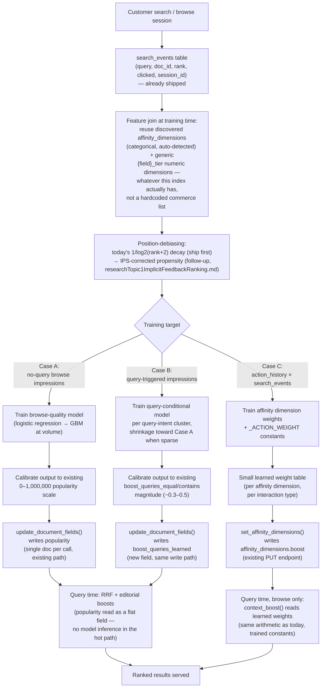

# Trained Re-Scorer — Learned Ranking Boosts (Case A / B / C)

> **Status: Case A implemented. Case B and C still proposed, not built.**
> Written before implementation, per the same "verify before implementing"
> pattern used elsewhere in this project (`webEnrichmentAgentDesign.md`,
> `superlativePriceDesign.md`). Every code reference below was checked
> directly against the current codebase, not assumed from other docs.
>
> **Case A build note:** implemented as a fully decoupled addition —
> `services/domain/popularity_trainer.py` (new, does not import or get
> imported by `analytics_service.py`), `routers/training.py` (new router,
> `POST /v1/training/popularity?index_id=&days=`), a `training_runs` table
> (new `CREATE TABLE IF NOT EXISTS` block in `database.py`'s `init_db()`),
> and `scikit-learn`/`numpy` added to `pyproject.toml`. `analytics_service.py`
> and `routers/analytics.py` have a zero diff. Verified: 6 new integration
> tests in `backend/tests/routers/test_training.py` (all passing, 30/30 with
> the existing suite, no regressions); a live end-to-end run against the
> Phones index (`22ffabfef4d1`) — seeded real `search_events` rows, called
> the endpoint, confirmed a trained model (`LogisticRegression`, held-out
> AUC 0.75 on the tiny seed set) wrote calibrated `popularity` values into
> Typesense in the expected 0–1,000,000 range, and logged a `training_runs`
> row. The seed events and their resulting scores were then removed/restored
> so the live demo index was left in its original state — that run was a
> mechanical smoke test of the pipeline, not a claim that an 11-event
> synthetic seed produces meaningful ranking quality; real quality
> validation still requires production-scale traffic per the Testing
> section below. One deliberate v1 scope decision made during
> implementation, not in the original design: trained **per index**, not
> pooled across indexes as the "Model" section below recommends longer-term
> — kept consistent with the existing per-index `?index_id=` endpoint shape
> for the first pass; pooling is a fast-follow, not a blocker.
>
> **2026-09 ranking-blend fix (post-implementation):** live testing on the
> Phones index showed the trained score doing exactly what "Open decisions"
> warned about — a Galaxy fold with a trained `popularity` of 1 000 000 ranked
> #1 for the query "iphone 17", because the additive `+ pop/2_000_000` rule
> gives the top-popularity doc +0.5 on *every* query, ~30× the entire RRF score
> range. Fixed by making `popularity` **query-aware** in a single shared
> `apply_editorial_boosts()` (used by all search paths): on a non-empty query it
> is a bounded multiplier `relevance *= (1 + 0.25 · pop/max_pop)` (≤ ×1.25, can
> reorder near-ties but never overturn a clear match); on empty-query browse it
> keeps the full additive `pop/2_000_000` (≤ +0.5) and Typesense sorts the whole
> collection by `is_featured,popularity` natively. `is_featured` and
> `boost_queries_*` stay additive merchandising overrides. Regression tests:
> `backend/tests/services/infra/test_editorial_boosts.py`. Full detail in
> `docs/scoreBoost.md`. Still additive and unaddressed: per-index `boost_rules`.

## Problem

ISP's ranking boosts are either a hand-written formula or hand-typed
constants — nothing in the ranking path today is learned from outcomes.

Traced live against the Phones index (`isp_22ffabfef4d1`, 51 documents):

- **`popularity`** is produced by `analytics_service.aggregate_popularity()`
  — a fixed formula (`1/log2(rank+2)` position decay, click weight `1.0` vs.
  impression weight `0.1`, normalized to 0–1,000,000). Before this formula
  had ever run against real traffic, 40 of 51 phones sat at `popularity = 0`
  — including the entire Galaxy S25 line, iPhone 15/16, and Pixel 9/10 —
  while 11 newest-launch phones had hand-set nonzero values. Nothing
  distinguishes a $1299 Galaxy S25 Ultra from a $229 Galaxy A17 in that
  field once both are at zero.
- **`context_service.py`'s personalization affinity weights** (`manufacturer
  +0.14`, `form_factor +0.10`, `os_family +0.09`, `viewed-not-purchased
  +0.05`, `purchased −0.30`) and **`_ACTION_WEIGHT`** (`purchase=3.0,
  cart=2.0, view=1.0, search=0.5, category=0.3`) are constants an operator
  types into the Personalisation tab or that live as hardcoded defaults in
  `context_service.py` — never validated against whether they actually
  predict clicks or conversions.
- A closely related bug was found and fixed in this same investigation:
  `price_tier`'s bucket thresholds were a global fixed `<30 / ≤80` dollar
  split (`context_service.py`, `affinity_service.py`) that put every phone
  except a $0 SIM card into "premium" — a static threshold problem, same
  category of issue as a static popularity formula, just for a different
  field. That fix (per-index percentile-derived thresholds, see
  `affinity_service._price_tier_thresholds`) is already shipped and is a
  useful reference for "hand-set constant → data-derived value" done at
  small scope. This doc is the same fix applied to the three boost layers
  that actually depend on click/conversion behavior, not just on the
  in-catalog price distribution.

## Current scoring formula (verified against code)

Four layers combine, not three, and one is conditional. Checked directly
against `backend/src/isp/services/infra/typesense_client.py` and
`backend/src/isp/routers/catalog.py`:

```
base  = RRF(lex_rank, sem_rank)                       [always]
base *= (1 + 0.25 · popularity/max_pop)               [non-empty query only]
score = base
      + popularity/2_000_000                          [empty-query browse only, ≤ +0.5]
      + is_featured / boost_queries_*                  [always, additive merchandising]
      + customer-context affinity / viewed-penalty     [browse only, q empty]
      + operator boost_rules                           [search- or browse-triggered, per rule]
```

(Updated 2026-09 — popularity was additive `+ pop/2_000_000` on all queries;
see the fix note at the top of this doc and `docs/scoreBoost.md`.)

- **RRF is rank-based, not score-based.** `0.7/(60+lex_rank+1) +
  0.3/(60+sem_rank+1)` (`typesense_client.py:336,338`) — raw BM25/cosine
  scores never enter the formula, only where each doc landed in each ranked
  list.
- **Editorial boosts**, always applied (`typesense_client.py:349-359`):
  `is_featured` → +0.5, `popularity` → up to +0.5
  (`min(pop,1_000_000)/2_000_000`), `boost_queries_equal` (exact match) →
  +0.5, `boost_queries_contains` → +0.3.
- **Customer-context affinity is browse-only** — `_apply_affinity = ... and
  not req.q.strip()` (`catalog.py:408`). A customer's action history never
  touches the score while they have an active search query.
- **Operator `boost_rules`** (`typesense_client.py:649`,
  `apply_boost_rules`, `docs/boostRules.md`) — a separate rule engine
  chained through the same post-RRF hook, clamped to +1.00 per rule.

Boost magnitudes are deliberately kept small relative to RRF so that boosts
*nudge* rather than override relevance — this constraint carries forward
directly into the trained re-scorer: every learned output below must be
calibrated into the same magnitude range as what it replaces.

## What already exists vs. what's net-new

This matters because the obvious plan — "log clicks, aggregate CTR, write
popularity" — is **already built**, not a green-field project:

| Piece | Status |
|---|---|
| `search_events` table (`index_id, session_id, query, doc_id, rank, clicked, source, created_at`) | **Shipped** — `database.py:88-98`, indexed on `(index_id, doc_id, created_at)` and `(created_at)` |
| Event logging (`POST /v1/analytics/impressions` batch, `POST /v1/analytics/click`) | **Shipped** — `routers/analytics.py`, `analytics_service.log_event` / `log_events_batch` |
| CTR → popularity aggregation (`POST /v1/analytics/aggregate`) | **Shipped, but formula-based** — `analytics_service.aggregate_popularity()`: position-discounted CTR (`1/log2(rank+2)`), not a trained model |
| Write-back to Typesense | **Shipped** — `analytics_service.apply_popularity()` → `ts.update_document_fields()` |
| Analytics summary/dashboard | **Shipped** — `GET /v1/analytics/summary`, `GET /v1/indexes/{id}/analytics` |
| **Trained model replacing the formula** | **Net-new — this doc** |
| Generic categorical feature discovery, any catalog | **Shipped** — `affinity_service.discover()` already auto-detects low-cardinality string fields per index, domain-agnostic |
| Generic numeric feature discovery (beyond `price`) | **Shipped as of this doc** — `affinity_service.py`'s sampling previously only captured `price`; generalised to detect *any* numeric metadata field and derive per-field `{field}_tier` dimensions (`low`/`mid`/`high`, same percentile mechanism as `price_tier`) — see "Feature discovery is generic, not commerce-specific" below |
| Position-debiasing (IPS/propensity, not just a decay curve) | **Net-new** — see `researchTopic1ImplicitFeedbackRanking.md` |
| Query-conditional boost (Case B) | **Net-new** |
| Personalization weight training (Case C) | **Net-new** |
| Feature-snapshot / training-data export | **Net-new** |
| Scheduled (repeated) training runs | **Net-new — no scheduler exists in this codebase at all** |
| ML dependencies (scikit-learn, numpy) | **Net-new — not in `pyproject.toml`** |

### Feature discovery is generic, not commerce-specific

An earlier draft of this doc listed `price`, `manufacturer`, `badges` as
"the" Case A feature set. That was wrong — ISP indexes non-commerce content
too (documentation, generic slug content per `docs/createPageUsingISP.md`,
service catalogs), and hardcoding commerce fields into the trainer would
break the same domain-agnostic principle the rest of the platform already
follows (verified: the chat pipeline, the content API, and — most directly
relevant here — `affinity_service.discover()` are all field-agnostic by
design).

The fix, already shipped as part of this doc rather than deferred:

- **Categorical features** — the trainer reuses whatever
  `affinity_dimensions` discovery already found for that index. No new
  mechanism: `affinity_service.discover()` auto-detects any low-cardinality
  string field (2–50 distinct values) purely from schema introspection —
  `category`/`manufacturer`/`operating_system` for Phones, but equally
  `doc_type`/`language`/`region` for a documentation or service index, with
  zero domain-specific code.
- **Numeric features** — previously *only* `price` was ever discovered
  (hardcoded field name check in the sampling loop); every other numeric
  metadata field was silently dropped, so a service index's `sla_hours` or
  a docs index's `word_count` never became a feature or a personalization
  dimension at all. Generalised in this session: the sampling loop now
  collects *any* numeric metadata field, and derives a generic `{field}_tier`
  dimension (`low`/`mid`/`high`, same 33rd/66th-percentile mechanism as
  `price_tier`) for each one with enough variety —
  `affinity_service._numeric_tier_thresholds()`, dispatched generically in
  `context_service.context_boost()`'s new `elif derived:` branch. `price`
  itself is unaffected — it keeps its historical `price_tier` naming and
  `budget`/`mid`/`premium` labels for backward compatibility; every *other*
  numeric field now gets the same tiering for free.

Case A/B's feature set below should be read as *"whatever this index's
discovery finds"* — the bullet list under Case A names the fields that
happen to exist for Phones as a concrete example, not a fixed schema.

Two architectural constraints inherited from the existing code, worth
stating up front rather than discovering mid-implementation:

- **`update_document_fields()` (`typesense_client.py:802-821`) is
  single-document only** — no bulk/batch Typesense import variant exists.
  `apply_popularity()` already loops one call per `doc_id`. A trained
  re-scorer's write-back inherits this same per-document call pattern; for
  catalogs in the thousands of items this is acceptable (seconds, not
  minutes), but it does not scale to a bulk nightly re-score of a
  million-item catalog without adding a batch import path — flagged here as
  a known limitation, not fixed by this doc.
- **No scheduler exists anywhere in this codebase.** No APScheduler, no
  Celery, no cron container in `docker-compose.yml`. `job_lock.py` is a
  Redis distributed mutex used to prevent concurrent ingest/rebuild across
  instances — it does not trigger anything on a timer. `POST
  /v1/analytics/aggregate` today is called on-demand only. **Decision for
  this design: keep training on-demand, triggered externally** (host
  crontab, k8s CronJob, or manual call), matching the existing pattern
  exactly, rather than adding new always-running in-process scheduling
  infrastructure. Revisit only if operational reality demands it.

## Flow diagram — end to end, all three cases



## Case A — browse popularity

**Goal:** replace `aggregate_popularity()`'s fixed decay formula with a
trained model, without changing its write target or read path.

**Training data:** `search_events` filtered to no-query (browse) impressions
— rows where the originating request had `q=""`. Reuse the existing table
and logging endpoints; no new instrumentation.

**Feature join (net-new):** at training time, join each `(index_id,
doc_id)` pair in `search_events` against that document's *current*
discovered feature set — not a fixed schema (see "Feature discovery is
generic, not commerce-specific" above):
- **Every enabled dimension in that index's `affinity_dimensions`** — for
  Phones, concretely: `category`, `manufacturer`, `operating_system`,
  `badges`, `price_tier` (categorical, auto-discovered); for a service or
  docs index this is whatever `affinity_service.discover()` found instead
  (e.g. `doc_type`, `sla_hours_tier`) — the trainer's code has no
  field-name assumptions.
- `is_featured` (boolean — note: this is a merchandising override, include
  it as a feature but do not let the model's own weight on it silently
  cancel out the operator's explicit +0.5; see Open Decisions)
- `averageStarRating` × `ratingsCount`, when present (currently unused as a
  ranking input anywhere in the codebase — new signal for the model;
  absent for non-commerce indexes, handled by simply not including it)
- Launch/`indexed_at` recency, as a decaying feature rather than a boolean
  "new" flag — universal across every index, not commerce-specific

**Position-debiasing:** ship v1 with the existing `1/log2(rank+2)` decay
already used in `aggregate_popularity()` — it is a decay curve, not a
propensity correction, but it is what's already running in production and
gives a working baseline immediately. Flag IPS/propensity-based debiasing
(randomized or interleaved traffic slice, examination-model fit) as a
documented v2 follow-up per `researchTopic1ImplicitFeedbackRanking.md`
(already scoped in the EB1-A folder) — do not block v1 on it.

**Model:** logistic regression (scikit-learn `LogisticRegression`) as the
default, trained as one model pooled across all indexes with index/catalog
identity as a categorical feature — not one model per index, since most
individual catalogs won't clear a reliable per-item data floor on their
own. Swap to gradient-boosted trees (`HistGradientBoostingRegressor`,
already in scikit-learn — no separate LightGBM/XGBoost dependency needed
unless volume genuinely justifies it) once an index's own traffic clears a
per-index training threshold (see Open Decisions for how that threshold
gets set).

**Output calibration:** the model's raw output must be scaled to land in
the same 0–1,000,000 range `aggregate_popularity()` already produces. What
that range *does* to ranking is now query-aware (see the 2026-09 fix note at
the top): on a non-empty query the score is normalised against the
highest-popularity candidate and applied as a bounded multiplier
(`× (1 + 0.25 · pop/max_pop)`), so absolute calibration matters less than
getting the *ordering* right; on empty-query browse it is still the additive
`min(pop,1_000_000)/2_000_000` (≤ +0.5) and calibration into that band
matters directly. Either way an uncalibrated score that clusters at one
end of the range collapses the signal — calibration stays a required
training-time step.

**Write-back:** unchanged — `analytics_service.apply_popularity()`'s
existing loop over `ts.update_document_fields()`, just fed the trained
score instead of the formula's output.

**New endpoint:** `POST /v1/analytics/train-popularity?index_id=` (or a
`method=trained` query param on the existing `/aggregate` endpoint — pick
one, see Open Decisions), on-demand, following the exact pattern of the
existing `POST /v1/analytics/aggregate`. Triggered externally on a schedule
(see scheduling decision above) — this endpoint does not schedule itself.

## Case B — query-conditional boost

**Goal:** replace the currently-unused `boost_queries_equal` /
`boost_queries_contains` manual curation (verified `None` on every Phones
document) with a learned, query-conditional relevance signal.

**Training data:** `search_events` rows where `q` is non-empty, joined the
same way as Case A, but keyed on `(query_cluster, doc_id)` rather than
`doc_id` alone.

**Query-intent clustering (net-new, the main new piece of this case):**
literal query strings fragment data too much ("cheap iphone" / "iphone
under 500" / "budget iphone" should pool). Cluster queries by intent before
aggregating — starting point: reuse the existing query embedding
(`embedding_service.embed_query()`, already computed for every search) and
cluster by cosine similarity, rather than building a separate NLP pipeline.
This keeps the clustering step dependent only on infrastructure that
already exists.

**Debiasing:** per query-result page, same decay-first / propensity-later
sequencing as Case A.

**Fallback/shrinkage:** when a `(query_cluster, doc_id)` pair has too
little data, blend toward Case A's item-level score rather than trusting a
noisy sample — simple empirical-Bayes-style shrinkage weighted by sample
size, not a hard cutoff.

**Scope boundary — do not duplicate the deterministic layers:** this model
must not fight `superlativePriceDesign.md`'s concept-to-field resolution
(deterministic "cheapest" → price sort) or
`deviceCompatibilityMatchingDesign.md`'s exact-variant matching. Training
data for those query types should be filtered out or the deterministic
match should take precedence at serve time — the learned boost models the
*residual* relevance those layers don't already resolve deterministically.

**Write target:** `boost_queries_equal` / `boost_queries_contains` are
today curated string-match lists (exact/contains semantics against the
literal query), which don't map cleanly onto a continuous learned score
against a query cluster. Recommend a **new field**,
`boost_queries_learned: dict[str, float]` (or a separate lookup keyed by
cluster id) rather than overloading the existing fields' string-match
semantics — same write mechanism (`update_document_fields`), new key.

## Case C — personalized affinity weights

**Goal:** replace `context_service.py`'s hand-set affinity weights
(`manufacturer +0.14`, `form_factor +0.10`, `os_family +0.09`,
viewed-not-purchased `+0.05`, purchased `−0.30`) and `_ACTION_WEIGHT`
(`purchase=3.0, cart=2.0, view=1.0, search=0.5, category=0.3`) with values
learned from actual outcomes.

**Training data:** `action_history` (already logged client-side, merged
into every search request per `docs/customerContext.md`) joined against
`search_events` — did a customer with a given affinity profile at time T
click/convert on item X at position P.

**What's learned:** not a per-customer model. A small weight table — one
value per affinity dimension (`category`, `form_factor`, `operating_system`,
`badges`, `manufacturer`, `price_tier`, and whatever else
`affinity_service.discover()` finds for a given index) and one value per
`_ACTION_WEIGHT` action type. This keeps query-time cost identical to
today: `context_boost()` (`context_service.py:140-206`) already does
`weight[dim] × affinity[dim][value]` arithmetic per request — only the
weights change from hand-typed to trained, not the computation shape.

**Write-back:** the existing `PUT /v1/indexes/{id}/affinity-dimensions`
endpoint and `index_service.set_affinity_dimensions()` — no new write path.
The UI already has editable `boost` and (as of this session's fix)
`thresholds` fields in the Personalisation tab; the trained weights populate
the same fields an operator can already see and override.

**Cold start:** unchanged — empty `action_history` → affinity boost `0` →
falls back to Case A/B, exactly as today's "additive, never override"
philosophy already guarantees.

## Full formula after all three cases land

Shape is unchanged from today — same 4 layers, same conditions. What
changes is which terms are hand-set vs. trained:

```
score = RRF(lex_rank, sem_rank)                          [unchanged]
      + is_featured                                      [unchanged — manual lever]
      + Case A score  (was: popularity formula)           [always, now trained]
      + Case B score  (was: boost_queries_equal/contains) [always, now trained]
      + Case C weights (was: hand-set affinity constants) [browse only, q empty — condition unchanged]
      + operator boost_rules                              [unchanged — manual lever]
```

`is_featured` and operator `boost_rules` stay manual deliberately — both
exist so an operator can override relevance on purpose (e.g. push a promo);
replacing operator intent with a learned number defeats the point of having
the lever.

## Migration

No migrations tool exists in this project — `database.py`'s `init_db()` is
the only schema-change mechanism, run once per app startup, using
idempotent `CREATE TABLE IF NOT EXISTS` / `ALTER TABLE ... ADD COLUMN IF
NOT EXISTS` blocks (see `search_events`'s own definition at
`database.py:88-98` as the pattern to follow, and the `affinity_dimensions`
column added via `ALTER TABLE` per the comment in `index_service.py`).

Net-new schema needed:
- A `training_runs` table (or similar) recording: `index_id`, `case`
  (`A`/`B`/`C`), `trained_at`, `model_type`, feature/hyperparameter summary,
  offline eval metrics (nDCG@10, MRR) — for auditability and for comparing
  runs over time. Not strictly required for v1 to function, but required to
  answer "did this training run actually improve anything" later.
- No change to `search_events` itself — it already carries everything Case
  A/B need.

## Testing

Follow the existing convention exactly — `backend/tests/`, integration
tests against a live server + real Postgres, no mocking
(`backend/tests/conftest.py`'s `client`, `db`, `test_index`, `seed_events`
fixtures). `test_analytics.py` already exercises `search_events` and
aggregation end-to-end; extend it or add `test_training.py` using the same
`seed_events(db, index_id, events)` helper to seed synthetic click data and
assert the trained score lands in the expected range and gets written back
correctly.

## Open decisions / risks

- **Endpoint shape for Case A:** new dedicated endpoint
  (`/train-popularity`) vs. a `method=` parameter on the existing
  `/aggregate` endpoint. Recommend the parameter approach — keeps one
  conceptual endpoint ("compute popularity") with two implementations,
  rather than two endpoints that can drift.
- **Scheduling:** on-demand-only (recommended, matches existing pattern) vs.
  adding APScheduler/Celery. Revisit if operational reality (someone
  forgetting to trigger it) makes this painful.
- **Per-index vs. pooled training threshold (Case A/B):** needs an
  empirical cutoff — e.g. a learning-curve check showing where offline
  nDCG stops improving with more data — before an index gets its own
  dedicated model instead of borrowing the pooled one. Not yet determined;
  requires real traffic data to calibrate, not something to guess up front.
- **`is_featured` interaction:** the model sees `is_featured` as a feature
  correlated with historically higher clicks (because featured items are
  already boosted +0.5 and shown more) — this is a feedback-loop risk
  (the model could learn to reward what the existing boost already
  rewards, inflating its own confidence in `is_featured` items). Needs
  either excluding `is_featured` items from training data, or explicitly
  correcting for the existing boost when computing the training label.
- **ML dependency footprint:** recommend scikit-learn + numpy only,
  consistent with this project's otherwise lean dependency list (no ORM, no
  pandas today). Add pandas only if the feature-join/aggregation code
  becomes unwieldy in plain Python — not assumed up front.
