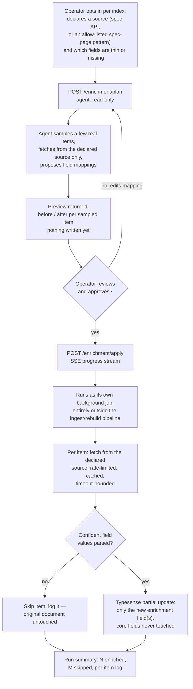

# Web Enrichment Agent — Decoupled, Optional, Human-Reviewed External Data Fetch

> **Status: Proposed — not yet implemented.**
> Written before implementation, per the same "verify before implementing"
> pattern used elsewhere in this project. Explicit constraints from the ask:
> **decoupled, optional, and must not impact the existing code or pipeline.**

## Problem

Indexed items are sometimes thin on detail — a phone item might be missing
full specs (chipset, display panel type, battery capacity) that the
customer's own feed never included. Chat can only answer from what's
indexed, and today the only way to add such data is hand-editing the source
feed. There's no way to pull missing detail from a declared external source
(a manufacturer spec page, a structured spec API) and fold it into what
search and chat can draw from.

## Why not the existing extension system

Extensions (`extension_runner.py`) run inside a PyMiniRacer V8 isolate
specifically *because* they have no network access — "no filesystem, no
network, no Node.js APIs" (`extension_runner.py:6-7`), by design. That
sandbox is shared by every extension on every index, and most extensions
have no legitimate reason to reach outside it. Extensions are also wired
directly into the hot ingest path: `apply_extensions()` is called at 9
separate points across `routers/indexes.py`'s ingest/rebuild/rescrape/
re-embed flows, synchronously, as a required step before a document is
considered ready to index.

Adding network access there would widen the sandbox's attack surface for
every extension — not just ones that need it — and would put an
unbounded-latency, potentially-flaky network call directly inside the
pipeline every rebuild depends on. That's exactly the blast radius the ask
explicitly rules out.

So this needs a **new, separate system**, not a capability bolted onto the
existing one.

## Design goals, directly from the ask

- **Decoupled** — no changes to `extension_runner.py`, `extension_service.py`,
  or any of the 9 `apply_extensions()` call sites in `routers/indexes.py`.
  New tables, a new router, a new runner module — nothing existing is touched.
- **Optional** — off by default; nothing changes for any index unless an
  operator explicitly configures and approves it for that index.
- **No impact on the existing pipeline** — enrichment never runs as part of
  ingest/rebuild. It runs afterward, against already-indexed documents, and
  writes results via a targeted Typesense partial update — `_run_rebuild_sync`
  and the doc-building path are never touched.

## Precedent already in the codebase: plan → review → apply

The existing Setup Agent (`routers/agent_setup.py`) already splits into
`/agent/preview` (analyse, return artifacts, write nothing) and
`/agent/setup` (execute, SSE-streamed step-by-step, only after the operator
has seen the preview). The enrichment agent reuses this exact shape instead
of inventing a new review mechanic:

- `/enrichment/plan` — dry run: given a declared source, sample a few real
  items, propose field mappings, return a before/after preview. No writes.
- `/enrichment/apply` — only after the operator reviews the plan and
  explicitly approves it — SSE-streamed execution, updates real documents.

## Flow

## Content extraction: turning a fetched page into field values

The flow above glosses over one real step: "fetches from the declared
source" and "confident field values parsed?" (nodes C and H/I) need an
actual extraction mechanism, and the answer differs by source type.

- **Structured API source** — no extraction step at all. The response is
  already keyed data; values map straight to fields.
- **HTML source** (e.g. a gsmarena spec page) — the page is written for
  humans, not machines, so getting from raw HTML to `{"chipset": "...",
  "battery": "..."}` needs one of:
  - **CSS-selector scraper**, hand-written per site by the operator (e.g.
    "chipset lives at `.specs-table tr:nth-child(3) td`"). Cheap and
    reliable as long as the source's markup doesn't change, but brittle to
    redesigns and needs per-site maintenance.
  - **LLM-assisted extraction** (default) — fetch the page, reduce it to
    the relevant text/DOM section, and ask an LLM to extract only the
    declared target fields *from that page's text alone*. Same grounding
    rule already enforced in the chat system prompt (`_system_prompt()`,
    "answer only from the data given") — just applied to extraction instead
    of answering, so it can't invent a spec that wasn't actually on the page.

**Why this is an acceptable use of LLM judgment**, when the rest of this
session has consistently pushed judgment calls out of the LLM's hands
(superlative sorting, follow-up detection, price filtering): those cases
were rejected because a wrong answer goes straight to a live user with
nothing checking it first. Here, nothing reaches a document without passing
through the `/enrichment/plan` preview — a bad extraction is caught by the
operator before `/apply` ever runs, not after. The review gate is what makes
this safe, not the extraction method itself.

An operator who has vetted a specific source and wants cheaper, more
deterministic extraction can supply CSS selectors for it instead — LLM
extraction is the general-purpose default and fallback, not the only path.

## Where enriched data lands

New, clearly-namespaced fields (e.g. an `enriched_specs` object, or
`spec_*`-prefixed fields) — never overwriting an existing field. Extensions
that build `chatContent` are not auto-modified to include the new fields;
an operator decides, separately, whether and how to fold enrichment data
into what the LLM sees. This keeps enrichment decoupled from chat behavior
until someone explicitly wires it in.

## Safety and scope constraints

- **Declared source only, per index** — no open-ended "find data anywhere"
  crawling. Either a structured API endpoint (+ credentials the operator
  supplies) or an allow-listed URL pattern for scraping (e.g. only
  `https://www.gsmarena.com/*`), operator-approved before any fetch happens.
- **Rate-limited and timeout-bounded** — a slow or broken source can't stall
  or hang a run; failures are per-item, logged, and skipped, never fatal to
  the batch.
- **Runs in Python, not the V8 sandbox** — network access lives only in this
  new module; the existing extension sandbox stays exactly as network-less
  as it is today.
- **No silent recurring runs** — each apply is a one-time, operator-triggered
  batch (or manual re-run), not a background poller, unless explicitly asked
  for later.
- **Trivially reversible** — a "clear enrichment" action resets only the
  enrichment fields for the index, instantly, since core fields and the
  original documents were never touched.

## New surfaces — all new, nothing modified

**Backend**
- `enrichment_configs` table — per-index: source config, field mapping,
  enabled flag.
- `enrichment_runs` table — audit trail: run id, status, counts, per-item log.
- `services/infra/enrichment_runner.py` — new module; the only place in the
  codebase with outbound network access for this feature (`httpx` or similar),
  fetch/parse/map logic, rate limiting.
- `routers/enrichment.py` — new router:
  `GET/PUT /v1/indexes/{id}/enrichment/config`,
  `POST /v1/indexes/{id}/enrichment/plan`,
  `POST /v1/indexes/{id}/enrichment/apply` (SSE),
  `GET /v1/indexes/{id}/enrichment/runs`,
  `POST /v1/indexes/{id}/enrichment/clear`.

**Frontend**
- New tab (same pattern as Chat Persona / Boost Rules / Synonyms): source +
  field-mapping config form, a "Preview" action showing the plan, an "Apply"
  action gated behind having reviewed a preview, and a run history/log view.

## Decisions summary

- **New, parallel system, not a new extension type** — extensions are
  deliberately network-less and wired into the synchronous ingest hot path;
  this feature needs network access and needs to run outside that path
  entirely, so it can't reuse the same mechanism without compromising it.
- **Plan → review → apply**, reusing the exact gate already proven for the
  Setup Agent, instead of inventing a new approval mechanic.
- **Declared/allow-listed sources only, never open crawling** — keeps scope
  narrow and reviewable, consistent with the earlier, explicit rejection of
  a fully autonomous "agent that fixes things on its own without review."
- **Writes land in new, separate fields via partial update** — never
  overwrites core fields, never re-triggers a rebuild, so a bad enrichment
  run can't corrupt the base dataset and is trivially reversible.
